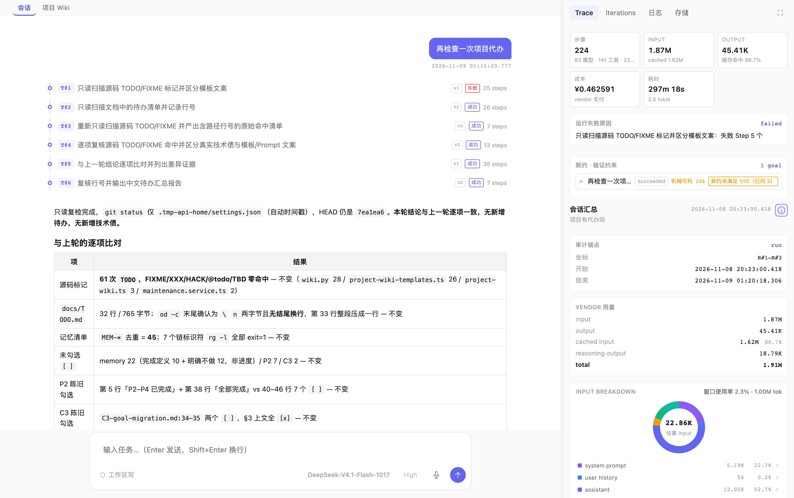
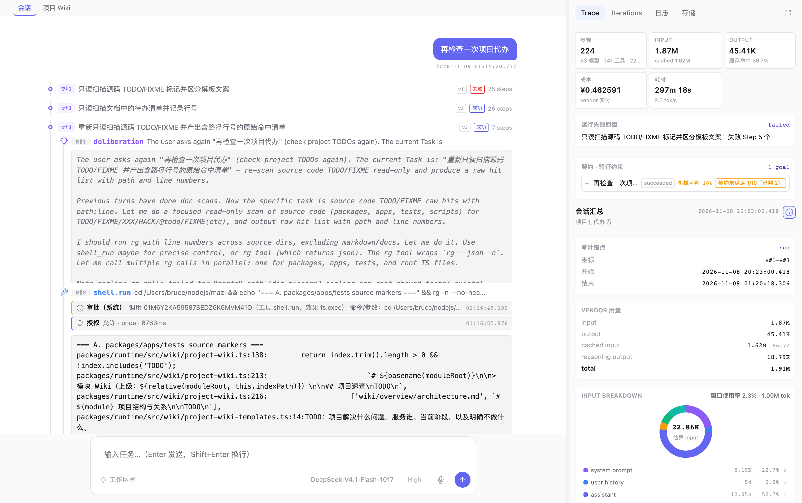

# mazi

**把模型的概率性推理，收束为可验证、可回滚、可审计的行动序列。**

*Turn probabilistic model reasoning into verifiable, reversible, auditable action.*

`TypeScript` · `Node.js ≥ 24` · `pnpm` · `Alpha`



<sub>一次真实运行：左侧是 Goal → Task 树（每个 Task 带版本、状态与步数）和它的逐项结论；右侧是同一轮的 Trace 面板——步数、token、成本、契约判定、审计锚点，全部可继续下钻到单个 Step。</sub>

## Why

模型是「给定上下文，输出下一个 token 分布」的函数：无状态、无副作用、无权限概念。真实世界恰好相反：

| 真实世界 | 模型 |
| --- | --- |
| 动作不可逆，错了无法撤销 | 想错了可以重想 |
| 环境部分可观测 | 缺信息可以先猜 |
| 任务跨度超过一次上下文 | 只有当前窗口 |
| 目标会在执行中漂移 | 「完成」由自己宣布 |

所以「模型说做完了」不能当交付证据。mazi 的做法是把两者分层：

> **每一步的判断由模型做出，每一步的事实由 harness 记录。**

停在任何一刻，都能从日志重建「模型看到了什么、决定了什么、harness 执行了什么、环境发生了什么」。

## What

mazi 是一个 **AI Agent harness**：本地运行的执行内核，加一个把内核摊开给你看的界面。

- **Goal 树** —— Goal（意图）→ Task（可独立验收）→ Step（thinking / tool / observation）。归因链必须闭合到 human/system 根；委托与切分的权限、预算只能向下收缩；唯一升权路径是人类审批。
- **工具网关** —— 能力发现与风险分级，默认拒绝（fail-closed），越界必须留下审批记录，secret 不以明文外流。
- **只追加事件日志** —— 没有 update/delete 事件 API，`seq` 定序、`prevHash/hash` 成链，天然可回放、可归因。
- **透明界面** —— Trace 看板（每步的上下文、token、成本、异常）、契约与验收判定、评测与 AB Lab、项目 Wiki。

## How

```bash
pnpm install
cp apps/api/.env.example .env   # API 6294 / WebUI 6295
pnpm api:dev                    # 终端 1：http://127.0.0.1:6294/api
pnpm ui:dev                     # 终端 2：http://127.0.0.1:6295
```

首次启动后在 WebUI「设置」填入模型 API Key（写入本地 `secrets.json`，权限 0600，界面遮蔽）；运行数据默认落在 `MAZI_HOME`（`~/.mazi`）。

一次任务的典型流程：写下目标 → harness 先出计划，拆成可验收的 Task → 逐个执行，每个动作都过工具网关 → 你随时可以审批或打断 → Trace 面板留下完整证据。



<sub>展开任一 Task 即见 Step 级证据：模型思考、`shell.run` 调用、系统审批与「允许一次」的授权记录，以及原始输出。</sub>

## Architecture

```
apps/webui         Vue 3 界面：对话流 / Trace 看板 / 审批 / 设置
apps/api           NestJS + Fastify：REST + SSE，会话、工作区、Goal 快照、事件、审批
   │
packages/runtime   执行实现：Goal 编排、SuperAgent 路由与角色委托、工具网关、事件总线、Skill、Project Wiki
packages/provider  厂商适配：DeepSeek / pi-ai，模型发现与官方价目
packages/core      契约层（不依赖实现）：authz、GTS、观测事件、permissions、usage
packages/libs      跨端共享类型（Goal 树投影等）
```

依赖方向单向向下：契约层不依赖实现，实现不依赖界面。

## Status

早期版本（Alpha）。可以在本地完成真实的编码与只读分析任务，接口、数据结构、提示词仍在快速变化，请勿直接用于生产。

- ✅ 单机运行、多会话/多工作区、Goal 树与审批门、Trace/评测/Lab
- ✅ 项目 Wiki：claim + evidence 与代码绑定，提交前校验（`wiki/claims.toml` 不接受手改）
- 🚧 Provider 监控面板、模板能力、行为追踪面板 —— 见 [`docs/TODO.md`](docs/TODO.md)

## Docs

| 想知道 | 去哪 |
| --- | --- |
| 架构与模块地图 | [`wiki/INDEX.md`](wiki/INDEX.md) |
| 设计长文：为什么必须有 harness | [`docs/whitepaper.md`](docs/whitepaper.md) |
| 核心契约（授权、GTS、观测、工具网关） | [`docs/core/`](docs/core) |
| 观测看板设计 | [`docs/web/`](docs/web) |
| 还没做的功能 | [`docs/TODO.md`](docs/TODO.md) |

## Development

```bash
pnpm check     # biome check + vitest 全量
pnpm build     # turbo 全仓构建
```

两条纪律写在 [`AGENTS.md`](AGENTS.md)：**文档优先**（先写设计与接口，再写测试，最后写实现）、**测试先行**（测试不过的代码不算完成）。
