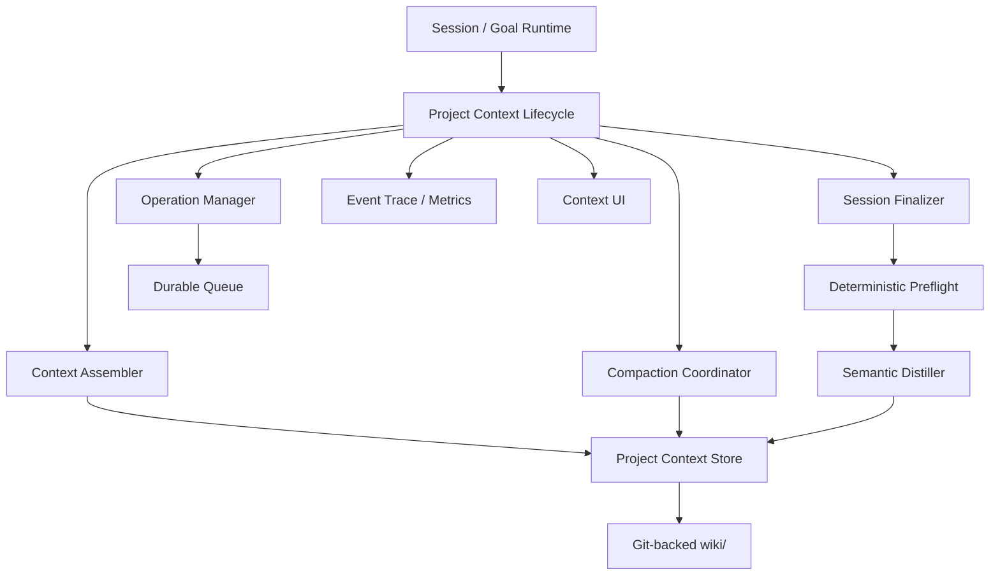
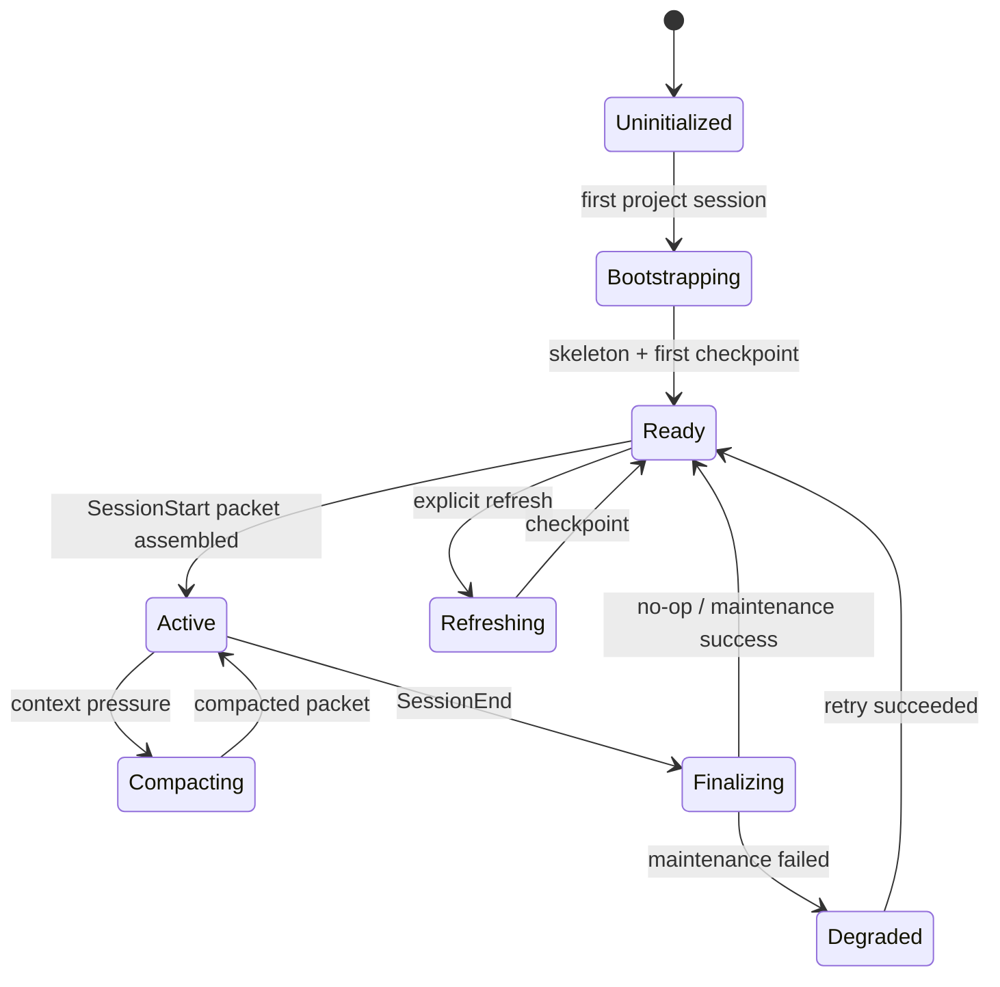

# Project Context Lifecycle Runtime 设计

> 状态：Phase 1 Implemented  
> 日期：2026-11-08  
> 范围：Mazi runtime 内置的项目级持久上下文能力  
> 默认存储：仓库内 `wiki/`（Git 文件格式）

---

## 1. 定位

### 1.1 一句话

Project Context Lifecycle（PCL）是 runtime 内置的项目记忆子系统：

> 在会话开始时按任务组装可验证的项目上下文，在会话中接收 durable 事实，
> 在上下文压缩时提供稳定锚点，在会话结束后异步沉淀变化，并为下一会话保留
> 可追溯、可校验、可继续演化的项目状态。

`wiki/` 是 PCL 的默认持久化格式，不是 PCL 的产品边界。

PCL 不通过 Agent 主动“记得更新 Wiki”来工作。初始化、加载、压缩、收尾、
校验、重试和可视化均由 runtime 生命周期驱动。

### 1.2 解决的问题

1. 新会话重复读取 README、部署文件、目录结构和历史决策。
2. 会话中学到的信息只存在于 transcript 中，会话结束后丢失。
3. 长会话压缩只保留泛化摘要，缺少事实证据、未完成事项和决策上下文。
4. 项目文件变化后，旧知识没有可靠的漂移检测。
5. Agent 输出与项目事实混在一起，无法判断哪些内容可以长期信任。
6. 自动更新依赖前台 Agent 自觉或外部 Skill 编排，不可靠且难以观察。

### 1.3 目标

| 目标 | 可验收结果 |
| --- | --- |
| 冷启动复用 | 第二次问同类问题时，不再完整读取项目 |
| 生命周期自动化 | SessionStart/SessionEnd 不依赖前台 Agent 决策 |
| 事实可追溯 | 每条稳定事实都能指向项目 evidence |
| 压缩可恢复 | 压缩摘要丢失后可从持久上下文重建 |
| 增量低开销 | 日常维护基于 diff/status/evidence oid，不扫描全项目 |
| 异步无感 | Wiki 维护不阻塞前台回答 |
| 可观察 | Trace 中能看到读取、推理、工具、错误、审批和 checkpoint |
| 可恢复 | API 重启后任务可继续或安全重放 |

### 1.4 非目标

- 不替代会话 transcript 或审计事件日志。
- 不把所有对话自动写成长篇文档。
- 不让模型自由修改 `claims` 的数值字段。
- 不把用户数据、密钥、日志正文写入项目知识。
- 不要求每个 turn 都更新项目记忆。
- 不把“事实是否成立”完全交给一次模型判断。

---

## 2. 核心原则

### 2.1 生命周期优先于存储格式

Markdown、TOML、SQLite 或向量库都只是后端。真正的产品能力是：

```text
bootstrap -> load -> work -> compact -> distill -> validate -> checkpoint
```

### 2.2 事实、状态、摘要分离

| 层 | 内容 | 权威性 | 生命周期 |
| --- | --- | --- | --- |
| 稳定事实 | 架构规则、部署约束、业务规则 | 高，需 evidence | 长期，变更需校验 |
| 项目状态 | 当前阶段、阻塞、下一步 | 中，随会话变化 | 短期到中期 |
| 最近增量 | 最近会话产物、文件变化 | 中，带时间 | 滚动保留 |
| 会话摘要 | 为压缩生成的派生描述 | 低，可重建 | 跟随 epoch |
| 原始 trace | 工具参数、输出、推理流 | 审计真源 | 按审计策略保留 |

会话压缩摘要不能充当唯一事实来源。它的作用是以更小 token 表示当前工作状态，
需要事实时必须回到稳定事实与 evidence。

### 2.3 确定性优先，语义判断后置

以下动作必须由 runtime 确定性完成：

- 工作区识别、Git checkpoint、diff/status；
- evidence oid 计算与 stale/missing 判断；
- 文件路径过滤、敏感目录排除；
- 操作排队、幂等键、重试、持久化；
- context packet 的预算裁剪和引用生成。

模型只处理需要语义判断的部分：

- 新事实是否 durable；
- 旧 claim 的语义是否仍成立；
- 多个文档应该如何概括；
- 会话增量中哪些内容影响后续工作。

### 2.4 上下文是投影，不是复制

新会话不会拿到整个知识库。Runtime 将持久上下文投影成当前任务需要的 Context Packet。
原始知识仍保存在项目仓库中，可追溯、可校验。

### 2.5 写操作必须可恢复

维护任务不能只存在于内存 Map 中。运行队列、操作状态、幂等键和 checkpoint
必须持久化；进程重启后至少满足：

- 已提交 checkpoint 不重复执行；
- 未完成任务可重试；
- 重复 SessionEnd 不会重复追加活动；
- 并发请求不会生成两个互相覆盖的维护任务。

---

## 3. 总体架构



### 3.1 模块职责

| 模块 | 职责 |
| --- | --- |
| `ProjectContextLifecycle` | 对外统一入口，编排整个生命周期 |
| `ContextAssembler` | 根据任务与 token 预算生成 Context Packet |
| `CompactionCoordinator` | 在上下文压缩前后保存/恢复项目锚点 |
| `SessionFinalizer` | 分析 SessionEnd 并决定是否维护 |
| `OperationManager` | 持久队列、状态、幂等、取消、重试 |
| `ProjectContextStore` | 稳定接口；默认实现为 Git-backed store |
| `SemanticDistiller` | 受限后台 Agent，只做语义更新 |
| `Context UI` | 展示文档、事实、状态、Trace、审批和维护记录 |

### 3.2 不变量

1. 同一 workspace 的最终写入串行执行。
2. 每个 Context Packet 都带 `checkpointId` 与内容哈希。
3. 稳定事实只能通过 Store API 写入。
4. evidence oid 由 runtime 计算，模型不能提供。
5. SessionEnd 维护失败不影响前台 Session 的完成状态。
6. 一次维护只有在上报最终结果或产生 checkpoint 时才算成功。
7. 用户数据目录、日志、密钥不进入探索沉淀候选。
8. 压缩摘要不提升为 evidence；它只能引用已有 evidence。

---

## 4. 数据模型

### 4.1 持久层

```text
<project>/
├── AGENTS.md
└── wiki/
    ├── INDEX.md
    ├── overview/
    │   ├── architecture.md
    │   ├── conventions.md
    │   ├── commands.md
    │   ├── deployment.md
    │   └── decisions/
    ├── state/
    │   ├── current.md
    │   └── lessons/
    └── claims.toml
```

未来 Store 可以切换为数据库或远程服务，但必须实现同样的逻辑接口。

### 4.2 Claim

```ts
interface ProjectClaim {
  id: string;
  text: string;
  status: 'active' | 'retracted';
  evidence: Array<{
    file: string;
    oid: string;
    hint?: string;
  }>;
  established: string;
  verified: string;
  retractedAt?: string;
  retractedReason?: string;
}
```

`stale` 与 `missing` 是运行时推导状态，不直接写入持久字段。

### 4.3 Checkpoint

```ts
interface ContextCheckpoint {
  id: string;
  commit: string;
  createdAt: string;
  documentCount: number;
  claimCount: number;
  contentHash: string;
}
```

Checkpoint 是项目上下文的逻辑版本，不等同于最近一次任意 Wiki 提交。
仅记录活动、不改变知识的提交不应重置增量 diff 基线。

### 4.4 Context Packet

```ts
interface ProjectContextPacket {
  workspace: string;
  checkpointId: string;
  query: string;
  intent: 'question' | 'change' | 'debug' | 'deploy' | 'review' | 'unknown';
  summary: string;
  facts: Array<{
    claimId: string;
    text: string;
    confidence: 'verified' | 'stale' | 'missing';
    evidenceRefs: string[];
  }>;
  currentState: string;
  relevantDocs: Array<{
    path: string;
    excerpt: string;
    reason: string;
  }>;
  recentDeltas: string[];
  unresolved: string[];
  warnings: string[];
  tokenEstimate: number;
  packetHash: string;
}
```

### 4.5 Session Envelope

```ts
interface ProjectSessionEnvelope {
  sessionId: string;
  workspace: string;
  projectId: string;
  input: string;
  finalAnswer: string;
  status: 'succeeded' | 'failed' | 'aborted';
  startedAt: number;
  endedAt: number;
  checkpointAtStart?: string;
  toolTraceDigest: ToolTraceDigest;
  changedFiles: string[];
  readFiles: string[];
  errors: string[];
}
```

---

## 5. 生命周期状态机



### 5.1 状态定义

| 状态 | 含义 |
| --- | --- |
| `uninitialized` | 没有可用上下文 |
| `bootstrapping` | 首次分析项目并建立骨架 |
| `ready` | 最近 checkpoint 可安全供新会话使用 |
| `active` | 会话正在使用 Context Packet |
| `compacting` | 正在生成长会话压缩锚点 |
| `finalizing` | SessionEnd 正在做增量评估与维护 |
| `refreshing` | 用户显式刷新项目上下文 |
| `degraded` | 上次维护失败，继续使用上一个可靠 checkpoint |

---

## 6. SessionStart：上下文组装

### 6.1 输入

```ts
interface AssembleContextRequest {
  workspace: string;
  sessionId: string;
  userInput: string;
  intent?: string;
  tokenBudget: number;
  conversation?: {
    recentMessages: number;
    lastCheckpoint?: string;
  };
}
```

### 6.2 组装流程

1. 解析 workspace 与最近可靠 checkpoint。
2. 读取 `INDEX.md`，确定候选文档范围。
3. 根据用户输入做轻量路由：
   - 部署/启动/端口 -> `deployment.md`、commands；
   - 架构/模块 -> `architecture.md`；
   - 业务规则/约束 -> `conventions.md`、claims；
   - 当前进度 -> `state/current.md`。
4. 选择相关 claims，优先 `active`，把 stale/missing 作为 warning。
5. 注入最近 delta 和未完成事项。
6. 按 token 预算裁剪并生成引用。
7. 在 trace 中记录 `context.packet.assembled`。

### 6.3 默认预算

| 区域 | 建议上限 |
| --- | --- |
| 项目摘要 | 400 tokens |
| 稳定事实 | 1200 tokens |
| 当前状态 | 400 tokens |
| 相关文档摘录 | 2000 tokens |
| 最近增量 | 600 tokens |
| warnings / unresolved | 300 tokens |

总预算由模型窗口动态计算，默认不超过窗口的 8%，超长任务可显式提高。

### 6.4 相关性排序

```text
score = intentMatch
      + claimFreshness
      + docRole
      + evidenceCoverage
      + recency
      - stalePenalty
      - redundancyPenalty
```

首版可以只做确定性关键词与文档角色路由；模型 rerank 仅作为可选增强。

### 6.5 SessionStart 失败

- 知识后端不可读：注入“项目上下文不可用” warning，继续普通会话。
- 没有初始化：进入 `bootstrapping`，不阻塞前台回答。
- 仅有 stale claims：允许使用，但在 packet 中明确标记。
- 没有任何文档：提供工作区结构与最近 Git 状态，不推测业务事实。

---

## 7. 活跃会话

### 7.1 读取

Agent 通过 runtime 提供的 `project_context` 能力读取：

- `context.index`：目录与路由；
- `context.search`：关键词检索；
- `context.claim`：读取单个事实及 evidence；
- `context.state`：当前状态；
- `context.packet`：当前会话的已组装包。

读取默认只读、免审批。

### 7.2 写入

会话中允许记录三类知识：

| 类型 | 示例 | 写入目标 |
| --- | --- | --- |
| 新事实 | “部署必须使用 9223 打印 Chrome” | claims + 对应 overview |
| 状态变化 | “当前阻塞是 BOSS 登录失效” | `state/current.md` |
| 决策 | “选择 Git-backed 而非数据库” | `overview/decisions/` |

写入先经过权限与路径校验，再由 runtime 计算 oid 和生成 checkpoint。

### 7.3 不应写入

- 普通寒暄；
- 可由单条命令即时获得的信息；
- 用户隐私数据；
- 未经核验的推测；
- 大段工具输出；
- 仅对当前 turn 有效的临时变量。

---

## 8. 长会话压缩

### 8.1 触发

压缩由 Context Manager 的窗口压力触发，不由模型主动决定：

```text
shouldCompact =
  historyTokens >= compactionThreshold * modelWindow
  || turnsSinceCheckpoint >= maxTurns
  || toolOutputBytes >= maxToolOutputBytes
```

### 8.2 压缩前

Runtime 先构造一个 `CompactionAnchor`：

```ts
interface CompactionAnchor {
  checkpointId: string;
  objectives: string[];
  constraints: string[];
  decisions: Array<{
    text: string;
    evidenceRefs: string[];
  }>;
  completed: string[];
  unresolved: string[];
  knownFailures: string[];
  activeFacts: string[];
  artifactRefs: string[];
}
```

### 8.3 必须保留

1. 当前用户目标与明确约束。
2. 已确认的项目事实及 claim/evidence 引用。
3. 已做出的架构或产品决策。
4. 已完成工作与验证结果。
5. 未完成任务、阻塞、失败原因。
6. 大输出的文件指针，而非完整输出。
7. 当前 context epoch 与 checkpoint。

### 8.4 可以丢弃

- 重复解释；
- 已被后续结果推翻的中间过程；
- 重复工具输出；
- 与当前目标无关的闲聊；
- 可由文件或日志重新读取的大段正文。

### 8.5 压缩后

生成新的 context epoch，并写入：

- `epochId`
- `sourceCheckpoint`
- `summaryHash`
- `retainedClaimIds`
- `artifactRefs`
- `compressedAt`

压缩摘要必须附带“如何重建”的指针。任何关键事实都可以回到 Wiki、源码或 artifact；
如果无法重建，则该摘要不能作为长期记忆。

---

## 9. SessionEnd：自动沉淀

### 9.1 阶段 A：确定性预检

SessionEnd 不先启动模型，而是完成以下工作：

1. 保存 Session Envelope；
2. 比较当前 checkpoint 与 HEAD / worktree；
3. 反查 evidence 涉及的 claims；
4. 计算全部 claims 的 evidence oid；
5. 从 trace 提取实际读取的安全项目文件；
6. 过滤 `data/`、日志、缓存、密钥和二进制；
7. 追加会话活动；
8. 输出维护计划。

```ts
interface FinalizePlan {
  changedFiles: string[];
  deletedFiles: string[];
  affectedClaims: string[];
  staleClaims: string[];
  missingEvidence: string[];
  researchFiles: string[];
  researchReadCalls: number;
  finalAnswerLength: number;
  needsSemanticReview: boolean;
  estimatedWork: 'none' | 'small' | 'medium' | 'large';
}
```

`changedFiles` 只包含当前工作区仍可读取的文件，供维护 Agent 按清单读取；
已删除文件进入 `deletedFiles`，不得放入可读取清单。删除项可能命中 claims 的
`missing` evidence，仍需参与语义判断，但 Agent 不得尝试读取不存在的路径。

### 9.2 阶段 B：分类

| 条件 | 动作 |
| --- | --- |
| 无 diff、无 stale、无高价值探索 | 仅记录活动 |
| 有 stale/missing | 增量 claims 维护 |
| 有高价值只读探索 | 知识沉淀 |
| 两者都有 | 合并为一个维护任务 |
| 只有普通闲聊 | 不启动模型 |

### 9.3 高价值探索判定

确定性候选：

- 实际读取过至少一个安全知识文件；
- 至少 6 次读取/检索动作，或最终答案达到有效长度；
- 最终答案不是纯寒暄、错误提示或空内容。

候选路径只允许：

- Markdown、源码、配置、脚本；
- workspace 内真实存在的文件；
- 非 `wiki/`、非 `data/`、非日志、非缓存、非密钥。

### 9.4 阶段 C：语义沉淀

维护 Agent 使用受限工具面：

- 只读文件；
- `project_context` 专用写接口；
- 不提供 shell、通用文件写、网络。

输入只包括：

- 用户问题；
- 最终回答；
- code diff 摘要；
- affected claims；
- research files；
- 当前相关文档摘录。

输出必须满足：

- 只写 durable、可复用、会影响后续行动的内容；
- 每条新事实有 evidence；
- 不复述整段回答；
- 不记录隐私数据；
- 更新完成后 checkpoint。

### 9.5 阶段 D：验证与提交

1. evidence 文件必须存在；
2. oid 必须由 runtime 计算；
3. stale/missing 必须修复或显式保留；
4. 文档路径必须在 context root 内；
5. 刷新检查点；
6. 只提交 context root，不提交用户源码改动。

### 9.6 成功判定

维护成功不等于“所有工具调用都成功”。成功条件：

```text
(Agent result ok)
||
(final answer exists && checkpoint committed during operation)
```

无关工具的失败必须保留在 trace 中，但不会把已经完成的 checkpoint 误报为失败。

---

## 10. Runtime 接口

```ts
interface ProjectContextLifecycle {
  status(workspace: string): Promise<ProjectContextStatus>;

  assemble(request: AssembleContextRequest): Promise<ProjectContextPacket>;

  writeFact(command: WriteFactCommand): Promise<WriteResult>;

  prepareCompaction(input: PrepareCompactionInput): Promise<CompactionAnchor>;

  finalizeSession(session: ProjectSessionEnvelope): Promise<ContextOperation>;

  refresh(workspace: string, options?: RefreshOptions): Promise<ContextOperation>;

  bootstrap(workspace: string): Promise<ContextOperation>;

  operation(operationId: string): Promise<ContextOperation>;
}

interface ProjectContextStore {
  loadIndex(workspace: string): Promise<ProjectIndex>;
  loadDocs(workspace: string, paths: string[]): Promise<ProjectDoc[]>;
  loadClaims(workspace: string): Promise<ProjectClaim[]>;
  writeDocs(workspace: string, changes: DocChange[]): Promise<void>;
  writeClaim(workspace: string, claim: ProjectClaim): Promise<void>;
  checkpoint(workspace: string, message: string): Promise<ContextCheckpoint>;
  doctor(workspace: string): Promise<ContextHealth>;
}
```

`GitProjectContextStore` 是首版默认实现。Runtime 的业务层不应直接依赖
`claims.toml`、`wiki.py` 或具体的 Wiki 文件路径。

---

## 11. 持久队列与并发

### 11.1 队列键

```text
workspace + operationKind
```

同一 workspace 的 bootstrap/finalize/refresh 写入串行；读取不受影响。

### 11.2 幂等键

- SessionEnd：`sessionId`
- 显式刷新：`workspace + checkpoint + requestId`
- 初始化：`workspace + projectIdentity`

### 11.3 持久状态

建议存储在：

```text
$MAZI_HOME/projects/<projectId>/context/
├── operations.jsonl
├── queue.json
└── locks/
```

事件正文仍由 runtime event log 保存，operations 只存状态和指针。

### 11.4 崩溃恢复

- `queued`：重新入队；
- `running` 且 trace 超时：标记 `interrupted`，允许安全重试；
- `checkpointed` 但未标记完成：执行幂等收尾；
- `failed`：保留错误，支持手动重试和指数退避。

---

## 12. 权限与安全

### 12.1 读写权限

| 操作 | 权限 |
| --- | --- |
| 读取 Context Packet | 项目只读 |
| 查询 claim | 项目只读 |
| 写入事实/状态 | workspace write |
| bootstrap/refresh | workspace write + 后台任务 |
| 删除或撤回事实 | 显式审批或高权限 |

### 12.2 数据边界

- 不把 `data/`、`.env`、证书、日志正文写入项目上下文。
- 大工具输出保存为 artifact，上下文只放引用。
- 从外部网页或文档得到的内容标记为 untrusted。
- 项目上下文不能提升工具权限。
- 自动维护不能提交源码；只能提交 context root。

### 12.3 审批

常规读取和 context root 写入不应要求用户逐个审批。
以下操作需要审批：

- 删除/清空 context；
- 写入 workspace 外路径；
- 访问受限数据源；
- 强制用 stale 事实生成 checkpoint；
- 批量 retract。

后台审批必须出现在 Context UI 的 trace 中，并可直接操作。

---

## 13. API 与 UI

### 13.1 API

```text
GET  /api/context?workspace=...
GET  /api/context/packet?workspace=...&input=...
GET  /api/context/claims
GET  /api/context/operations/:id
POST /api/context/bootstrap
POST /api/context/refresh
POST /api/context/finalize
POST /api/context/compact-anchor
```

现有 `/api/wiki/*` 可在迁移期保留为兼容别名。

### 13.2 UI 信息架构

页面名称建议改为“项目上下文”或“项目记忆”，包含：

- 项目摘要与当前状态；
- 稳定事实、证据、漂移；
- 文档导航；
- 最近变化与会话活动；
- 后台维护 Trace；
- 审批；
- 压缩 epoch 与锚点；
- 上次 checkpoint 和下次恢复点。

Wiki 文档只是其中一个展示分区，不再代表整个功能。

---

## 14. 可观测性

### 14.1 事件

```text
context.bootstrap.started
context.bootstrap.completed
context.packet.assembled
context.packet.missed
context.compaction.started
context.compaction.completed
context.finalize.queued
context.finalize.plan.created
context.finalize.agent.started
context.finalize.checkpoint.completed
context.finalize.failed
context.claim.stale
context.claim.missing
```

### 14.2 指标

- Context Packet token 数；
- packet 命中率；
- 重复读取率；
- claim stale/missing 数；
- bootstrap 成功率和耗时；
- finalize 成功率、重试率和耗时；
- 每会话上下文维护成本；
- 压缩后问题恢复率。

### 14.3 UI Trace

Trace 不能只显示生命周期事件，还应显示：

- 模型 reasoning/text stream；
- 每次工具名、参数、输出；
- policy denied；
- approval requested/granted/rejected；
- checkpoint 输出；
- 最终成功/失败原因。

---

## 15. 故障策略

| 故障 | 行为 |
| --- | --- |
| Store 不可读 | 正常对话，注入上下文不可用 warning |
| 无 Git | 使用只读文件索引；禁用 checkpoint 并明确提示 |
| 模型不可用 | 保留确定性计划和活动记录，等待重试 |
| checkpoint 失败 | 不推进版本，保留旧 checkpoint |
| 任务重启 | 从持久队列恢复 |
| stale claim 未修复 | 阻止全量 checkpoint，或显式 `force` 并记录 |
| 工具失败但 checkpoint 成功 | 标记成功并保留 warning trace |
| Context UI 未打开 | 后台任务照常执行 |

---

## 16. 迁移路径

### Phase 0：职责收回

- 把 SessionStart 注入、SessionEnd 排队、探索分析和成功判定迁入 runtime。
- API 只负责 HTTP、鉴权和投影，不保存维护业务状态。
- 不再通过 Agent Skill 判断何时初始化和更新。

### Phase 1：Context Packet

- 实现 `ContextAssembler`。
- 将现有 `INDEX.md` 全量注入替换为按任务投影。
- 为 packet 增加 hash、token 估算和 trace。

### Phase 2：压缩集成

- 接入 `ContextManager` 的压缩决策点。
- 生成 CompactionAnchor。
- 压缩后恢复 claim 引用、未完成任务和 artifact 指针。

### Phase 3：持久队列

- 将内存 operations 迁到 durable store。
- 增加幂等键、重试、崩溃恢复。

### Phase 4：Git Store 内部化

- 用 TypeScript `GitProjectContextStore` 替代运行时对 Python CLI 的依赖。
- 保留 `wiki.py` 作为兼容/运维工具，不再是生命周期驱动入口。

### Phase 5：UI 重构

- 把“项目 Wiki”改为“项目上下文”。
- 文档页、事实页、生命周期页和 Trace 共用一个状态模型。
- `/api/wiki/*` 作为兼容层逐步废弃。

---

## 17. 验收标准

1. 新项目首次会话后台建立上下文，不阻塞首轮回答。
2. 已完成项目的新会话只注入相关 Context Packet，不注入整个知识库。
3. 用户询问部署后，即使没有源码改动，下一会话能复用部署事实。
4. 普通寒暄不启动维护模型。
5. 文件变化后能通过 oid 找到受影响 claims。
6. 长会话压缩后，目标、约束、事实引用、未完成项不丢失。
7. 压缩摘要可丢弃并从持久上下文重建。
8. 进程重启后，未完成维护任务不会丢失。
9. 同一 SessionEnd 重复投递不会重复记录或重复提交。
10. 敏感目录不会进入探索沉淀和 Context Packet。
11. trace 能定位每次维护使用了哪些文件和 claims。
12. 维护不修改或提交用户源码。

---

## 18. 待决策项

1. Claim 是否支持行区间 evidence，还是继续保持整文件 oid。
2. 多分支项目是否按 branch 隔离 checkpoint。
3. Context Packet 是否使用小型模型 rerank，还是仅规则路由。
4. 项目合同、ADR、issue 是否进入同一存储。
5. 压缩 epoch 与 Git checkpoint 是否强制一一对应。
6. 团队协作时，多个 Agent 的并发写入采用锁、merge 还是事件合并。
7. 用户是否可配置不同项目的自动沉淀强度。

---

## 19. 当前实现落点

| 能力 | Runtime 实现 |
| --- | --- |
| Project Wiki 文件与 Git 操作 | `packages/runtime/src/wiki/project-wiki.ts` |
| Claim 解析、序列化、oid 和状态 | `packages/runtime/src/wiki/project-wiki-claims.ts` |
| 领域中立模板、AGENTS 指针和模块骨架 | `packages/runtime/src/wiki/project-wiki-templates.ts` |
| 独立运维 CLI | `packages/runtime/src/wiki/project-wiki-cli.ts` |
| SessionStart 初始化与上下文注入 | `packages/runtime/src/harness/runtime.ts` |
| 后台 SessionEnd 编排 | `apps/api/src/wiki/maintenance.service.ts` |
| API 读取与事实治理 | `apps/api/src/wiki/wiki.controller.ts` |
| Project Wiki UI | `apps/webui/src/components/WikiPage.vue` |

事实修正使用 `correctClaim`：

- 创建新 active claim；
- 旧 claim 标记为 `retracted/corrected`；
- 记录 `superseded_by`、`supersedes` 和原因；
- 旧事实不再进入 Context Packet。

明确遗忘使用 `forgetClaim`：

- claim 标记为 `retracted/forgotten`；
- 后续 doctor、Context Packet 和增量维护都忽略该事实；
- Context Packet 会过滤掉文档中与已撤回 claim 完全相同的旧事实行；
- Git 中保留审计历史。

`packages/runtime/builtin-skills/project-wiki/scripts/wiki.py` 仅作为外部兼容入口，
Mazi 的 Harness、API 和后台维护均不再执行 Python。

