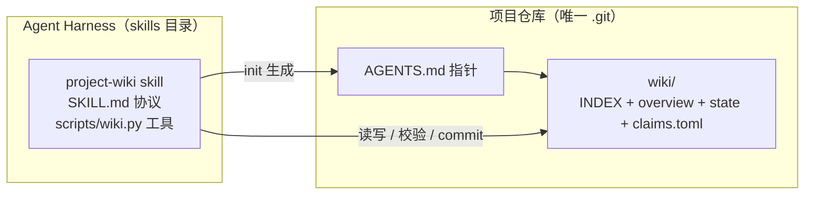
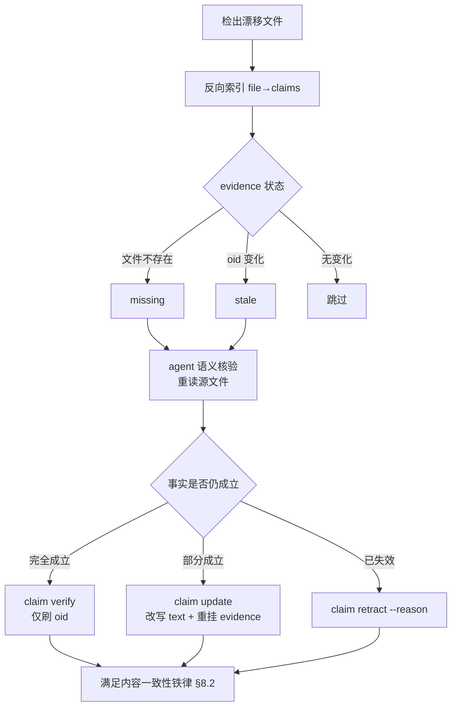
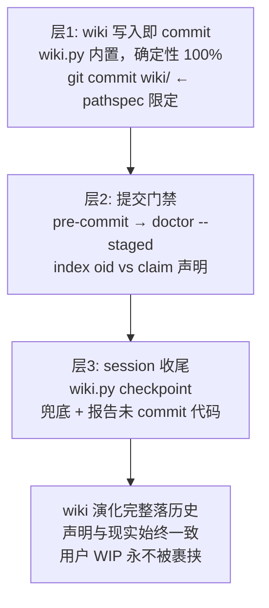
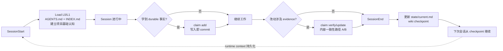

# 项目 Agent Wiki 设计文档（v2）

> 形态：Skill（程序）+ Wiki（产物）· 零第三方依赖 · Git 硬依赖 · 不绑定任何 agent 框架

---

## 1. 概述

### 1.1 问题

Agent 每次接手项目都要重读代码对齐上下文：成本高、易漏易错、且每次重复。静态文档写完即过期，无法承载“项目现在进行到哪”的动态状态。
本设计把项目知识做成一个**活的、可验证的、随会话演化的 wiki**：会话开始时从它建立项目认知，会话进行中学到的事实当场写回，会话结束打点持久化——下次会话从这里继续，而不是从零开始。

### 1.2 目标

| 目标                 | 度量                                                         |
| -------------------- | ------------------------------------------------------------ |
| 冷启动成本最小化     | 典型会话 wiki 相关 token < 6k                                |
| 事实可验证且按需校验 | 会话启动零校验，按需毫秒级单点校验                           |
| 运行时闭环           | SessionStart 建立认知 → 会话中回写 → SessionEnd checkpoint |
| 演进可持续           | 三层 commit 自动化 + 漂移修复闭环，不依赖人的自觉            |
| 零依赖可移植         | 纯 stdlib 单文件工具；skill 一次安装，服务所有项目           |

### 1.3 定位一句话

**Wiki 是 skill 的产物**：`project-wiki` 这个 skill 提供协议与工具（程序），在项目里长出并维护 `wiki/` 目录（数据）。程序安装在 harness 的 skills 目录，数据在项目仓库里随 git 演化，二者严格分离。
--------------------------------------------------------------------------------------------------------------------------------------------------------------------------

## 2. 核心设计决策

| 决策点                  | 选择                                                                                                     | 一句话理由                                                  |
| ----------------------- | -------------------------------------------------------------------------------------------------------- | ----------------------------------------------------------- |
| **程序/产物分离** | Skill = 程序（SKILL.md + scripts/wiki.py，装在 harness skills 目录）；wiki/ = 产物（纯数据，在项目仓库） | 混居会搅乱信任分级与分发；skill 一次安装服务所有项目        |
| wiki/ 内容边界          | 只有知识数据：INDEX + overview + state + claims.toml                                                     | 协议在 SKILL.md，工具在 skill 内，wiki/ 无任何可执行物      |
| 发现入口                | AGENTS.md 一行指针指向 SKILL.md                                                                          | 中立标准；指针是纯文本路径，任何 harness 的 agent 都能读    |
| 载体                    | Markdown + TOML                                                                                          | git 协作、人可读、无渲染依赖                                |
| 事实验证                | Claims 机制 + git blob oid                                                                               | git object model 本身就是 Merkle DAG，不自建树              |
| oid 来源                | **按场景四模式分配**（§7.2）                                                                      | 声明用工作区、门禁用 index，语义必须分开                    |
| evidence 粒度           | 整文件 hash                                                                                              | 行区间 hash 在上方增删行时产生大量假 stale；hint 仅作导航   |
| claim 颗粒度            | 事实单元（语义边界）                                                                                     | 跨 N 个文件的一条事实是一个 claim                           |
| 原子性                  | **内容一致性铁律**（双达成路径）                                                                   | 门禁验终态一致，不强制 commit 边界                          |
| wiki commit             | pathspec 限定，写入即 commit                                                                             | 同一个 `.git`，只提交 `wiki/` 路径；用户 WIP 永不被裹挟 |
| Git 依赖                | **硬依赖**：检测 → 平台安装指引 → 拒绝核心功能                                                   | git 三职合一（校验引擎+事件流+checkpoint 锚点）             |
| claim_oid               | 可选字段，默认关闭                                                                                       | 内容寻址扩展点；不需要时零成本                              |
| monorepo                | 嵌套 wiki（产物），skill 全仓库一份                                                                      | 一个工具管理多份数据                                        |
| 检索                    | grep                                                                                                     | 几百 KB 规模内完全够用                                      |

---

## 3. 总体架构



|          | Skill（程序）                                                 | Wiki（产物）               |
| -------- | ------------------------------------------------------------- | -------------------------- |
| 位置     | harness 的 skills 目录（如 `.claude/skills/project-wiki/`） | 项目仓库内 `wiki/`       |
| 内容     | SKILL.md（协议）+ scripts/wiki.py（工具）                     | 纯知识数据                 |
| 变更频率 | 低（随协议演进，版本化升级）                                  | 高（随会话演化）           |
| 信任要求 | **最高**——强制机制的执行者                            | 分层（§13）               |
| 分发     | 独立分发包，安装一次                                          | 不分发，每个项目自己长出来 |
| 版本     | `wiki.py --version`                                         | 随项目 git 演化            |

---

## 4. 目录结构

### 4.1 Skill 包（独立分发单元）

```
project-wiki/                     ← 安装到 harness 的 skills 目录
├── SKILL.md                      # 协议本体（含 frontmatter，§10）
└── scripts/
    └── wiki.py                   # 全部基础设施，单文件纯 stdlib
```

**安装位置**：

| 方式                                                                                                                                                  | 路径                                    | 特点                                            |
| ----------------------------------------------------------------------------------------------------------------------------------------------------- | --------------------------------------- | ----------------------------------------------- |
| **项目级（推荐）**                                                                                                                              | `<repo>/.claude/skills/project-wiki/` | 随 git 分发、团队一致、pre-commit hook 路径稳定 |
| 用户级                                                                                                                                                | `~/.claude/skills/project-wiki/`      | 跨项目复用；hook 写绝对路径，CI 环境需同样安装  |
| 其他 harness 的 skill 目录约定不同时，复制或 symlink 到对应目录即可——**发现权威入口始终是 AGENTS.md 的指针**（纯文本路径，任何 agent 可读）。 |                                         |                                                 |

### 4.2 项目仓库（产物）

```
repo/                            ← 唯一的 .git 在仓库根
├── AGENTS.md                    # L0 入口（3-5 行），指针指向 SKILL.md 与 wiki
└── wiki/                        # ★ skill 的产物：纯数据，无可执行物
    ├── INDEX.md                 # 路由表 ≤50 行（L1），含模块地图
    ├── overview/                # 静态事实层（人工主责，偶尔改）
    │   ├── architecture.md
    │   ├── conventions.md
    │   ├── commands.md          # init 从 Makefile 等预填
    │   ├── deployment.md
    │   └── decisions/           # ADR
    ├── state/                   # 动态状态层（agent 主责，频繁改）
    │   ├── current.md
    │   └── lessons/
    └── claims.toml              # 事实注册表（只经 wiki.py 修改）
```

### 4.3 monorepo（嵌套 wiki，两层封顶）

```
repo/
├── AGENTS.md
├── .claude/skills/project-wiki/ # skill 全仓库唯一一份（项目级安装）
├── wiki/                        # 根 wiki：只放跨模块事实
│   ├── INDEX.md                 # 模块地图（枢纽）
│   ├── overview/
│   └── claims.toml
└── services/
    ├── auth/
    │   ├── AGENTS.md            # 3 行指向根 skill + 本模块 wiki
    │   └── wiki/                # 模块 wiki（纯数据）
    └── billing/
        └── wiki/ ...
```

**归属三规则**：
| 信息 | 归属 | 示例 |
|---|---|---|
| 模块内部事实 | 该模块 claims.toml | "auth 的 JWT 过期时间 15 分钟" |
| 跨模块事实 | **永远归根 wiki**（单一归属，两处存必然漏改一处） | "auth 通过 Kafka 发 order-events 给 billing" |
| 全局约定/架构 | 根 overview/ | 部署拓扑、跨服务命名规范 |
-----------------------------------------------------------

## 5. 信息分层与准入

### 5.1 四级渐进披露

| 级                                                          | 内容                   | 加载时机                         | 成本     |
| ----------------------------------------------------------- | ---------------------- | -------------------------------- | -------- |
| L0                                                          | AGENTS.md 指针         | 每会话常驻                       | ~100 tok |
| L1                                                          | INDEX.md 路由表        | 会话开始                         | ~600 tok |
| L2                                                          | SKILL.md + 主题文件    | 首次会话读协议；其余 grep 命中后 | 2-4k tok |
| L3                                                          | claims 条目 + 校验报告 | 质疑事实时                       | <500 tok |
| 典型会话总成本 **< 6k tokens**，整库通读往往 20-50k。 |                        |                                  |          |

### 5.2 准入原则

> **代码无法自述的全局认知才写；代码能自述且单次读取成本可控的局部细节不写。**
> Wiki 定位：**“代码无法自述的那部分认知的缓存”**。
>
> | 类型                                   | 写否 |
> | -------------------------------------- | ---- |
> | 函数签名、单文件实现细节               | ❌   |
> | 跨模块数据流、架构分层、依赖图         | ✅   |
> | 设计决策、踩坑教训、领域术语、业务规则 | ✅   |
> | 进行中任务、阻塞、常用命令、禁忌红线   | ✅   |

---

## 6. Claims 机制

### 6.1 数据格式

```toml
# wiki/claims.toml — 只通过 wiki.py claim 修改，禁止手改
[claims.auth-jwt]
text = "认证采用 JWT + Redis 黑名单，吊销 token 5 分钟内生效"
status = "active"                    # 落盘仅 active | retracted；stale/missing 运行时推导
evidence = [
  { file = "src/auth/jwt.py",             hint = "L40-82", oid = "fb947d…" },
  { file = "src/auth/redis_blacklist.py", hint = "L15-48", oid = "a3b8e1…" },
]
established = 2026-11-02
verified   = 2026-11-06
# claim_oid = "x3f9a…"              # 可选扩展点，默认关闭
```

**retract 后的字段**（`wiki.py claim retract` 强制要求 `--reason`）：

```toml
status = "retracted"
verified   = 2026-11-06              # 冻结不动
retracted_at = 2026-11-07
retracted_reason = "迁移至 PASETO v4，JWT 相关事实全部失效"
```

`retracted` 的 evidence 豁免一切校验，保留作历史参照——“留痕不删除”由此有明确字段承载。

### 6.2 oid 的语义

**blob oid 是文件内容的纯函数**：`oid = H("blob " + size + "\0" + content)`，`git hash-object <file>` 直接读工作区文件计算，**与该文件是否被 commit 无关**。
wiki commit 的本质是固化一个**数值声明**：“写下这条 claim 的时刻，工作区里 `src/auth/jwt.py` 的内容对应的 oid 是 fb947d…”。它不存储文件内容——内容在后续的代码 commit 才进 git 历史，两者通过同一个 oid 数值对齐，不需要在同一个 commit 里。
**“读哪个 oid”随场景而变，见 §7.2 四模式表**——这是正确性的关键细节。

### 6.3 Claim 与 Evidence 是 N:M 映射

- 一个 claim 挂多个 evidence；一个文件被多个 claim 引用
- 不同 evidence 的 oid **通常不同**（指向不同文件），但内容相同的文件（如大量空 `__init__.py`）**共享同一 blob oid**——不影响任何逻辑，校验恒按路径逐一比对，不依赖 oid 相异性
- 颗粒度启发式：**“什么样的 PR 会推翻它？”**——“任何 touching 该文件的 PR”→ 太细；“重大架构升级”→ 太粗；“改了 X 模块的 Y 行为”→ 正确

### 6.4 claim_oid 扩展点（可选）

```
claim_oid = H( text ‖ evidence[0].oid ‖ … ‖ status ‖ verified )
```

用途：跨 wiki 引用精确版本（`auth-jwt@x3f9a…`）、外部系统订阅事实变更、聚合为 wiki root_oid 做组织级快照。默认不生成。

### 6.5 多文件改动处理流程



---

## 7. 事实验证体系

### 7.1 成本事实

**主路径根本不算 hash**：从 git index 读缓存的 oid（`git ls-files -s`），毫秒级。需要现算时（未跟踪文件、工作区比对）：SHA-1 约 750 MB/s，SHA-256 有 SHA-NI 硬件加速达 GB/s；1000 claims × 3 evidence ≈ 30MB → 十至百毫秒级。**计算从来不是瓶颈**，全量校验的真正问题是语义浪费：绝大多数文件没变，重算是无用功。

### 7.2 oid 四模式表（正确性关键）

`git hash-object` 读**工作区**，`git ls-files -s` 读 **index（staged）**——两者语义不同，必须分配正确：

| 场景                                                                                                                                                                                                                           | oid 来源                               | 语义                                                                       |
| ------------------------------------------------------------------------------------------------------------------------------------------------------------------------------------------------------------------------------ | -------------------------------------- | -------------------------------------------------------------------------- |
| **claim 写入**（add/update）                                                                                                                                                                                             | 工作区（`git hash-object`）          | 声明“我此刻验证过的内容”——agent 刚改完文件、尚未 add，正是要声明的状态 |
| **pre-commit 门禁**（`doctor --staged`）                                                                                                                                                                               | **index**（`git ls-files -s`） | 校验“将被提交的内容”与声明一致；工作区的后续改动不参与                   |
| **运行时漂移检测**（默认 / `--claim`）                                                                                                                                                                                 | 工作区                                 | 检测提交后的漂移，含 staged-未提交的 WIP                                   |
| **快速初筛**（`--git-status`）                                                                                                                                                                                         | `git status`                         | stat 缓存预筛                                                              |
| **Git 即 Merkle DAG，不自建树**：blob 叶子 → tree 中间节点 → commit 根；index 缓存每个文件的 blob oid，cached tree extension 缓存子目录级 hash——增量验证能力原生提供。**Merkle 层交给 git，wiki 只做语义层。** |                                        |                                                                            |
| oid 算法**跟随仓库对象格式**（默认 SHA-1，可切 `--object-format=sha256`）；claims.toml 存完整 hex，长度 40–64 不写死。                                                                                                |                                        |                                                                            |

### 7.3 分层校验策略（四级阶梯）

| 级                    | 触发时机                         | 动作                                      | 成本   |
| --------------------- | -------------------------------- | ----------------------------------------- | ------ |
| **L0 信任**     | 每次会话开始                     | 零校验，直接读 INDEX                      | 0      |
| **L1 轻量初筛** | SessionStart hook（可选）        | `doctor --git-status`，报告注入 context | <100ms |
| **L2 惰性校验** | agent 质疑某条 claim 时          | `doctor --claim <id>` 单点校验          | 几 ms  |
| **L3 全量**     | **CI / checkpoint / 手动** | `doctor --all`                          | 秒级   |

> **注**：pre-commit（§8.3）使用 `--staged`，属于**提交门禁**维度，不属于此运行时校验阶梯——二者互补而非同一层。
> **L0 为什么成立**：门禁 + CI 已保证“漂移的 commit 进不来”，wiki 在会话开始时几乎总是新鲜的，主动全量是在重复已完成的工作。未配 hook 的团队用 L1 补偿。L2 是默认语义校验——按需验一个子树，而非每次验所有。

---

## 8. Commit 自动化体系

### 8.1 两个前提

**时机**：触发点是 **task 完成**（代码+claim 一致性）与 **session 结束**（checkpoint），不是每轮对话。
**对象**：自动 commit **严格限定为 wiki 自身**。工作区可能有用户 WIP、实验代码、密钥——agent 无权替人判断“该不该进历史”。

### 8.2 内容一致性铁律

同一 claim 的所有 evidence 必须在任意时点描述同一个代码状态；禁止“evidence[0] 新、evidence[1] 旧”的半新半旧中间态。两条达成路径，门禁只验**终态一致**：

| 路径                                                                         | 流程                                                                  |
| ---------------------------------------------------------------------------- | --------------------------------------------------------------------- |
| **A 同 commit**                                                        | 代码与 claim 变更一起提交                                             |
| **B wiki 先行**                                                        | claim 即时 commit → 代码随后提交，两次 commit 之间 evidence 内容未变 |
| 风险窗口（两次 commit 之间 evidence 又被改）由门禁在代码 commit 时抓住拦截。 |                                                                       |

### 8.3 三层自动化架构



**层 1 —— 写入即 commit**：

```python
def auto_commit(wiki_root, message, no_commit=False):
    if no_commit:                       # 逃生门：攒着和代码一起提
        return
    run(["git", "add", str(wiki_root)])
    run(["git", "commit", str(wiki_root), "-m", message])   # pathspec 限定
```

`git commit wiki/` 只提交该路径的变更：用户已 staged 的 `src/app.py` 原样留在暂存区，未 staged 改动与 untracked 文件完全不动。`.git` 全项目唯一，wiki/ 与 skill 目录都是仓库里的普通目录——blob oid 校验、pre-commit hook、checkpoint 三件事都依赖同一个仓库。
**层 2 —— 提交门禁（pre-commit hook）**：
`.git/hooks/pre-commit` 全部内容就是一行：

```bash
#!/bin/sh
python3 "$(git rev-parse --show-toplevel)/.claude/skills/project-wiki/scripts/wiki.py" doctor --staged
```

（用户级安装时由 init 写入绝对路径并提示 CI 需同装。项目使用
`core.hooksPath`/Husky 时，init 写入当前生效的 hook 入口；Husky 下落到
`.husky/pre-commit`，不覆盖 `.husky/_` 的转发脚本。）
wiki.py 内部：`git diff --cached --name-only` 取 staged 清单 → `git ls-files -s` 读 **index oid** → tomllib 解析 claims.toml 建精确 path→oid 映射 → 逐一比对。无子串误匹配（`jwt.py` 不会误命中 `jwt.py.old`），无 hash 长度硬编码。
**“staged 后又被修改”场景的闭环**：

| 场景                                                                                                                        | index oid | claim oid | 结果                                                                    |
| --------------------------------------------------------------------------------------------------------------------------- | --------- | --------- | ----------------------------------------------------------------------- |
| 声明后未再改                                                                                                                | D         | D         | 放行 ✓                                                                 |
| add 后又被改（工作区 = E）                                                                                                  | D         | D         | 放行 ✓（提交的是 D，与声明一致；E 是未提交 WIP，运行时 doctor 报漂移） |
| add 了旧内容 C，claim 声明 D                                                                                                | C         | D         | **拦截**：重新 `git add` 或 `claim update`                    |
| **层 3 —— checkpoint 兜底**（§9.4）：doctor 不过关拒绝打点；发现未 commit 代码涉及 claims 时**报告不代劳**。 |           |           |                                                                         |

### 8.4 Git 硬依赖

```bash
git --version              # ① 二进制存在？
git rev-parse --git-dir    # ② 在 git repo 内？
```

| 检测结果                                                                  | 行为                                                                                                               |
| ------------------------------------------------------------------------- | ------------------------------------------------------------------------------------------------------------------ |
| ①② 都过                                                                 | 正常运行                                                                                                           |
| ① 失败                                                                   | 核心子命令全部拒绝；打印平台指引（apt / dnf / brew / winget）；`setup-env` 交互式安装，`--auto` 供 CI/容器镜像 |
| ② 失败                                                                   | 询问后自动 `git init`，提示初始 commit                                                                           |
| 不保留 no-git 降级：git 是校验引擎 + 事件流 + checkpoint 锚点，三职合一。 |                                                                                                                    |

---

## 9. 运行时生命周期

### 9.1 闭环



### 9.2 框架集成三形态

| 形态                 | 可靠性 | 原理                               |
| -------------------- | ------ | ---------------------------------- |
| 框架生命周期 hook    | ★★★ | 宿主进程强制执行，不经 LLM 决策    |
| 显式 tool call       | ★★   | LLM 决定调用，tool schema 是强提示 |
| SKILL.md 协议指示    | ★     | 纯靠 LLM 遵守（兜底）              |
| 三者叠加，各司其职。 |        |                                    |

**v1 过渡规则**：`project-wiki` Skill 已挂载时，runtime 关闭旧版
`$MAZI_HOME/wiki` 快照注入、自动记录及 `wiki.read/wiki.update` 工具面；
项目内 wiki 只按本 Skill 的脚本协议维护。未挂载时才保留 v1 行为。

### 9.3 首次冷启动（overview 不是 init 自动编出来的）

1. `wiki.py init` 只生成骨架，并确定性预填技术栈与从 Makefile、package scripts、
   justfile、Taskfile 提取到的命令。
2. INDEX 仍是 TODO 或 claims 为空时，agent 读取 README、包/工作区清单、
   AGENTS 约定以及关键入口源码。
3. agent 填写 architecture、conventions、INDEX 简介/模块地图与 state/current；
   无法确认的内容保留 TODO。
4. agent 为核心机制建立首批 claims，evidence 指向真实文件，然后 checkpoint。

README 是首次理解的输入之一，不是自动事实源；`init` 不会把 README 宣传语
直接写入 overview。

### 9.4 checkpoint：SessionEnd 收尾

1. doctor 全量校验（工作区现算，不依赖 commit 状态）
2. 发现未 commit 的代码改动涉及 N 条 claims → **报告，不代劳**
3. agent 更新 state/current.md（语义部分）
4. commit wiki 变更 + 刷新 INDEX 最近更新块
5. 打印会话摘要（checkpoint = HEAD，下次会话从这里继续）
   双重语义：**wiki 的同步点** + **runtime context 的持久化锚点**（隐式 = `git log -1 -- wiki/`）。不引入状态文件，就没有状态文件自己过期的问题。

---

## 10. CLI：scripts/wiki.py

### 10.1 设计原则

- 单文件、纯 stdlib（tomllib / pathlib / subprocess），当前约 1100 行，自带 `--version`
- 模板内嵌字符串常量 → init 自包含
- 就近解析：从 cwd 向上找最近 wiki root（AGENTS.md / wiki/），所有子命令自动作用于它——skill 装在何处无关紧要，工具操作的是**调用时所在的项目**
- oid 永远脚本现算（按 §7.2 四模式），**从不信任 agent 报的数**；TOML 原子写入（.tmp + rename）

```
wiki.py
├── init [--per-module]              # 落 wiki/ 骨架 + AGENTS.md + 装 hook
├── claim
│   ├── add    --id --text --ev [..]
│   ├── verify --id | --all
│   ├── update --id --text --ev [..]
│   └── retract --id --reason        # reason 必填
├── doctor  [--all | --claim <id> | --git-status | --staged | --ci]
├── update  --plan                   # 漂移修复工作清单
├── checkpoint                       # SessionEnd 收尾（一级命令）
├── setup-env [--auto]               # git 安装引导
└── root                             # 打印就近 wiki root（调试）
```

所有写操作内置自动 commit（§8.3 层 1），`--no-commit` 逃生门。

### 10.2 init

前置：skill 已安装（本项目级或用户级 skills 目录）。在项目根执行：

```bash
python3 .claude/skills/project-wiki/scripts/wiki.py init
```

幂等生成 wiki/ 骨架，只补缺失，**永不覆盖**已有内容。确定性提取：

| 检测目标                                                                                                                                                                                 | 来源                                                                    | 产出                                                                      |
| ---------------------------------------------------------------------------------------------------------------------------------------------------------------------------------------- | ----------------------------------------------------------------------- | ------------------------------------------------------------------------- |
| 技术栈                                                                                                                                                                                   | pyproject / go.mod / package.json / Cargo.toml / pom.xml                | INDEX 简介、architecture 骨架                                             |
| 真实命令                                                                                                                                                                                 | Makefile / package.json scripts / justfile / Taskfile                   | commands.md **直接预填**                                            |
| monorepo 结构                                                                                                                                                                            | pnpm-workspace / go.work / turbo.json / services\|apps\|packages 启发式 | INDEX 模块地图预填（`--per-module` 同时生成各模块 wiki/，skill 不复制） |
| 部署线索                                                                                                                                                                                 | .github/workflows / Dockerfile / helm                                   | deployment.md 章节                                                        |
| **收尾**：探测自身安装路径写入 pre-commit hook + AGENTS.md 追加 `<!-- WIKI:START/END -->` 指针块（已存在则不重复）+ 打印首会话引导提示（可粘贴给 agent），把冷启动填库纳入协议。 |                                                                         |                                                                           |

### 10.3 doctor —— 分层校验引擎（oid 来源见 §7.2）

| 模式             | 行为                                                                                                                                           |
| ---------------- | ---------------------------------------------------------------------------------------------------------------------------------------------- |
| `--git-status` | L1 初筛，输出适合会话启动注入的报告                                                                                                            |
| `--claim <id>` | L2 惰性单点校验，毫秒级                                                                                                                        |
| 默认             | L3 当前 root 全量：oid 比对（stale/missing）、INDEX 链接可达性、**`wiki/**/*.md`（当前 root 内，不含 claims.toml）单文件 >150 行告警** |
| `--all`        | L3 递归所有嵌套 root，按 root 分组；行数告警扩展到各 root 同名范围                                                                             |
| `--staged`     | 提交门禁：staged 文件的 **index oid** 与 claim 比对，不符 → 退出码非零                                                                  |
| `--ci`         | 兜底：missing = 失败，stale = 告警                                                                                                             |

### 10.4 确定性 / 语义分界

| 子命令     | 脚本（确定性）                             | agent（语义）                         |
| ---------- | ------------------------------------------ | ------------------------------------- |
| init       | 生成骨架、命令提取、装 hook                | 填 TODO、建首批 claims                |
| claim      | oid 计算（四模式）、TOML 写入、自动 commit | 提供 text、判定 verify/update/retract |
| doctor     | index/工作区 oid 比对、链接检查            | 修复动作执行                          |
| update     | 漂移检测、按 claim 分组的工作清单          | 逐条核验                              |
| checkpoint | 全量校验、INDEX 刷新、wiki commit          | 写 state/current.md                   |

---

## 11. Agent 协议（SKILL.md）

### 11.1 协议本体

```markdown
---
name: project-wiki
description: 项目知识库(wiki/)的读写与维护协议。检索项目背景、确认事实、
  记录新知识、更新任务状态或校验 claims 时使用。
---
# 项目 Wiki 协议
wiki/ 是本项目对 agent 的唯一事实库。三条铁律：
1. 动手前先查 wiki，不推测项目约定
2. 会话中学到 durable 事实，当场写入（写入即自动 commit，无需手动提交）
3. 代码改动使已记录事实漂移 → 满足内容一致性（同 commit 或 wiki 先行均可）
## 会话生命周期
- SessionStart：读 wiki/INDEX.md 建立基础认知（若 hook 注入了 doctor
  --git-status 报告，先扫一眼哪些事实可能 stale）
- 任务完成：代码 commit 前，同步更新受影响的 claims
- SessionEnd / 任务收尾：执行 python3 <skill-dir>/scripts/wiki.py checkpoint
  （或调用 wiki_checkpoint tool，若本环境已注册）
## 读取（渐进式，禁止整库通读）
1. 需要细节：grep -rni --include="*.md" -e "<关键词>" wiki/overview wiki/state
2. 命中后 cat 文件
3. 质疑某条事实：grep "<claim-id>" wiki/claims.toml，
   然后 python3 <skill-dir>/scripts/wiki.py doctor --claim <id>
   单点校验（毫秒级，不要全量 doctor）
## 写入
新增事实：
  python3 <skill-dir>/scripts/wiki.py claim add --id <slug> \
    --text "<一句话事实>" --ev <文件> [--ev ...]
  同时把可读版本写进对应 overview/ 或 state/ 文档
事实漂移（doctor 报 stale/missing，或本次改动涉及某 claim 的 evidence）：
  1. python3 <skill-dir>/scripts/wiki.py update --plan 拿清单
  2. 逐条重读源文件 → verify / update / retract 三选一
  3. 满足内容一致性铁律后提交代码
## 红线
- 代码能自述的不写；只写事实/规则/指针，不写叙述散文
- claims.toml 禁止手改，oid 一律由脚本计算
- 绝不自动 commit 用户的代码改动，wiki.py 只提交 wiki/ 路径
- 单个 wiki 文档 >150 行必须拆分
```

`<skill-dir>` 即本 SKILL.md 所在目录（安装路径随 AGENTS.md 指针确定）。

### 11.2 AGENTS.md（L0，保持 3-5 行）

```markdown
# Agent 指南
- 项目知识库在 wiki/INDEX.md，会话开始必读；改代码前先查对应模块 wiki
- wiki 读写协议见 .claude/skills/project-wiki/SKILL.md
- 工具：python3 .claude/skills/project-wiki/scripts/wiki.py（不要手改 claims.toml）
- 模块地图见 wiki/INDEX.md
```

### 11.3 wiki_checkpoint tool call（可选注册）

支持自定义 tool 的框架可注册：

```json
{
  "name": "wiki_checkpoint",
  "description": "会话收尾：校验 wiki 一致性、持久化当前 state、提交 wiki 变更。
                  在任务完成或会话结束时调用。不会 commit 用户的代码改动。",
  "parameters": { "summary": "本次会话做了什么（写入 state/current.md）" }
}
```

description 里“不会 commit 用户的代码改动”同时消除 agent 的调用顾虑和使用者的安全疑虑。自有框架可进一步在 `task_complete` / `session_end` 生命周期事件上挂 `checkpoint --auto`（state 摘要由事件参数传入，不经 LLM 决策），“agent 忘了”被彻底消掉。
--------------------------------------------------------------------------------------------------------------------------------------------------------------------------------------------------------

## 12. 初始化流程（端到端）

```
1. 获取 skill 包        独立分发（git repo / zip）
2. 安装                 复制到 harness skills 目录（推荐项目级，随 git 团队共享）
3. 项目内 init          wiki.py init → wiki/ 骨架 + AGENTS.md + pre-commit hook
4. 首会话引导           agent 读 SKILL.md → INDEX.md → 填 architecture TODO、建首批 claims
5. 日常运行             三层自动化接管（§8.3），doctor 报告驱动漂移修复
```

---

## 13. 一致性保障体系

| 层                                                                                                                                                                                                                           | 机制                                                                  | 强制程度                    |
| ---------------------------------------------------------------------------------------------------------------------------------------------------------------------------------------------------------------------------- | --------------------------------------------------------------------- | --------------------------- |
| wiki 写入                                                                                                                                                                                                                    | 写入即 commit（pathspec 限定），演化不依赖自觉                        | 硬（确定性）                |
| 提交时                                                                                                                                                                                                                       | pre-commit `doctor --staged`：index oid vs 声明 → 不符即拒绝       | 硬                          |
| 会话内                                                                                                                                                                                                                       | 三铁律 + checkpoint（doctor 不过关拒绝打点）                          | 中                          |
| 按需                                                                                                                                                                                                                         | `doctor --claim <id>` 惰性单点校验                                  | 中                          |
| **归属权（三级信任）**                                                                                                                                                                                                 | 见下表                                                                | 硬                          |
| 兜底                                                                                                                                                                                                                         | CI `doctor --ci`：missing 失败 / stale 告警                         | 硬/软                       |
| 可追溯                                                                                                                                                                                                                       | git history 即事件流；retract 留痕（retracted_at / retracted_reason） | 结构性                      |
| **CODEOWNERS 三级信任**（程序/产物分离的直接收益）：                                                                                                                                                                   |                                                                       |                             |
| 路径                                                                                                                                                                                                                         | 信任等级                                                              | review 策略                 |
| ---                                                                                                                                                                                                                          | ---                                                                   | ---                         |
| skill 目录（SKILL.md + wiki.py）                                                                                                                                                                                             | **最高**——强制机制的执行者                                    | 全量人工 review，版本化升级 |
| `wiki/overview/` + 各级 claims.toml                                                                                                                                                                                        | 高——事实层                                                          | 人工 review                 |
| `wiki/state/`                                                                                                                                                                                                              | 低——状态层                                                          | agent 可自动合并            |
| **诚实的风险声明**：tool call 形态下 agent 忘调 checkpoint 的可能性存在（★★）。协议+工具保证“漏了会被抓到、抓到知道怎么修”；“agent 自觉”无法 100% 强制——配置 SessionStart/SessionEnd hook 可消掉“忘记”变量。 |                                                                       |                             |

---

## 14. 演进路线

| 阶段                                             | 动作                                                                                                          | 升级信号                                                                           |
| ------------------------------------------------ | ------------------------------------------------------------------------------------------------------------- | ---------------------------------------------------------------------------------- |
| **第 1 天**                                | 安装 skill → `wiki.py init`：落骨架 + commands.md 预填 + AGENTS.md 指针 + hook                             | —                                                                                 |
| **第 1 周**                                | 首会话引导：agent 填 architecture TODO、建首批 claims                                                         | —                                                                                 |
| **第 2-3 周**                              | 观察数据：每周必 stale 的 claim 切太细；无人查的条目说明 INDEX 路由失效                                       | —                                                                                 |
| **按需**                                   | 补 SessionStart/SessionEnd hook；注册 wiki_checkpoint tool；monorepo 时 `init --per-module`；启用 claim_oid | 服务 3-5 个独立迭代 → 拆嵌套 wiki；单服务 >2 万行 → 服务内分目录（不嵌套第三层） |
| **升级到重型方案的触发条件**（满足其一）： |                                                                                                               |                                                                                    |

1. 服务数 > 5 且跨服务检索成为日常
2. 需要无人值守的定时 LLM update 循环
3. 需要跨仓库 workspace / MCP 集成

---

## 15. 附录

### 15.1 INDEX.md 模板

```markdown
# <项目名>
> 一句话：<做什么、给谁用、当前阶段>
## 速查
| 想知道 | 去哪 |
|---|---|
| 架构与模块 | overview/architecture.md |
| 怎么写代码 | overview/conventions.md |
| 常用命令 | overview/commands.md |
| 当前进行中的事 | state/current.md |
| 历史决策 | overview/decisions/ |
## 红线（违反会出 bug）
1. src/generated/ 任何情况下不要手改
2. 数据库迁移必须走 make migrate
3. 提交前必须跑 make check
## 模块地图（monorepo 时）
<见 §4.3>
## 最近更新
<!-- recent:start -->
<!-- recent:end -->   ← 由 wiki checkpoint 维护
```

### 15.2 关键机制速查

| 问题                              | 答案                                                                                                |
| --------------------------------- | --------------------------------------------------------------------------------------------------- |
| 程序在哪、数据在哪                | 程序 = skill 包（harness skills 目录，SKILL.md + scripts/wiki.py）；数据 = 项目仓库内 wiki/，纯产物 |
| oid 从哪来                        | 按场景四模式（§7.2）：写入读工作区，门禁读 index，漂移检测读工作区，初筛用 status                  |
| wiki commit 存了什么              | oid **数值声明** + text，不存文件内容；内容在代码 commit 进历史                               |
| 两份历史如何对齐                  | 同一个 blob oid 数值；门禁在代码 commit 时验声明 vs index 现实                                      |
| 单独 commit wiki 会不会碰用户代码 | 不会，pathspec 限定只提交 `wiki/` 路径，用户暂存区原样保留                                        |
| 同一 claim 的 evidence oid 相同吗 | 不同文件通常不同 oid，但内容相同的文件共享 blob oid；校验按路径逐一比对，不依赖相异性               |
| 换 harness 怎么办                 | 复制/symlink skill 到新 harness 的 skills 目录；AGENTS.md 指针同步更新即可，wiki/ 数据不动          |

---

## 16. 交付清单

```
✅ project-wiki skill 包（SKILL.md 协议 + scripts/wiki.py 单文件工具
   + wiki_checkpoint tool 定义，独立分发，--version 标识）
✅ wiki/ 目录骨架（INDEX + overview + state + claims.toml，init 永不覆盖）
✅ AGENTS.md 入口指针（monorepo 时各模块一份；skill 全仓库一份）
✅ pre-commit hook（一行调用 doctor --staged）+ CI job（doctor --ci）
✅ 本文档
```

**当前 `scripts/wiki.py` 约 1100 行，包含骨架生成、claims、doctor、漂移清单和 checkpoint。先跑两周，用 doctor 报告校准 claim 颗粒度与 INDEX 路由，再决定后续演进。**
