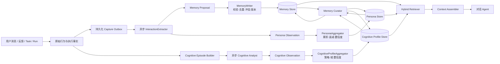

# AHF Runtime 长期记忆、人格与认知过程画像设计

> 版本：v1.1
> 状态：设计稿，待评审
> 日期：2026-11-04
> 范围：Runtime 长期记忆、用户行为证据、人格画像、认知过程画像、异步抽取、检索与治理
> 相关文档：`docs/runtime/AHF_RUNTIME_MEMORY.md`、`docs/用户行为流设计文档.md`、`docs/用户问题标签与分类设计.md`、`docs/web/迭代面板设计.md`、`docs/runtime/AGENT_P0_P3_IMPLEMENTATION_PLAN.md`

## 1. 结论

Agent 长期记忆不是在上下文窗口之外无限堆叠对话，而是在固定窗口外维护一条受治理的数据闭环：

```text
原始行为与执行事实
  → 写入门控
  → 结构化事实/事件/人格证据/认知证据
  → 持久化与索引
  → 作用域安全的混合检索
  → 冲突消解与预算注入
  → 反思、合并、衰减与遗忘
```

系统需要同时回答三类问题：

1. **任务问题**：当前任务需要知道什么事实、决策、约束和经验？
2. **用户问题**：这个用户是谁，如何沟通、反馈、判断和协作更合适？
3. **认知问题**：用户如何理解问题、选择切入口、分解任务、验证假设、处理阻塞和形成结论？

三者不能混成一张无差别记忆表。事实记忆追求明确、可验证和可替代；人格画像追求交互偏好与反馈模式；认知过程画像描述可观测的问题解决策略及其在项目中的演化。

### 1.1 核心决定

- 闲聊、感谢、生气、批评和反馈不是噪声。它们可以不进入事实记忆，但必须进入行为证据抽取。
- LLM 只提出记忆和人格观察，不能直接获得数据库写权限；作用域、状态、版本、来源和确认策略由 Runtime 决定。
- 首版使用“异步 Extractor + 确定性聚合器 + 低频 Curator”，不建设有自主写权限的 Memory Agent。
- 单次愤怒只能形成受场景约束的瞬时证据，不能直接固化为“用户易怒”等稳定人格判断。
- “用户思维链分析”正式定义为**用户可观测认知过程建模**，只使用用户输入、选择、纠正、授权和任务轨迹，不复用或冒充模型隐藏推理。
- 认知画像分为跨场景的认知策略画像和项目/主题域内的认知状态快照，二者不能互相替代。
- 所有召回先执行租户和用户硬隔离，再进行相关性排序。
- 当前代码、Git、测试、工具返回、GoalContract 和审计事实始终优先于记忆与画像。

## 2. 设计目标与非目标

### 2.1 目标

- 跨会话、跨任务召回明确事实、偏好、决策、约束和可复用经验。
- 从问答、闲聊、感谢、批评、情绪反应、评分、打断和授权行为中提取画像证据。
- 从长对话和项目过程重建用户的问题建构、切入角度、分解方式、探索顺序、假设检验、纠偏和收敛过程。
- 维护用户对具体项目或知识域的认知状态快照，支持后续解释层级、澄清方式和协作策略调整。
- 降低上下文 token 消耗，并避免陈旧、冲突、候选记忆进入模型上下文。
- 支持事实、人格和认知画像的可追溯、纠正、删除、导出、重建与版本化。
- 在单用户本地部署和多租户部署下使用同一套硬隔离语义。
- 对写入可靠性、检索质量、画像准确性和隐私风险建立可回归的门禁。

### 2.2 非目标

- 首版不把全部对话原文直接写入向量库。
- 首版不允许对话 Agent 自由新增、覆盖或删除长期记忆。
- 首版不自动改写 system prompt，不自动上线程序性规则。
- 首版不依据单次表达进行心理诊断、政治立场推断或敏感属性推断。
- 首版不生成“认知能力高低”评分，不把认知画像用于人格优劣、权限或资源分配。
- 首版不把模型 thinking 链视为用户思维过程；TOC 仅用于分析模型自身推理与系统迭代。
- 首版不强制引入图数据库；先证明实体关系和多跳检索确有业务收益。
- 首版不建设独立常驻的自主记忆 Agent 进程。

## 3. 数据平面

| 平面 | 回答的问题 | 示例 | 生命周期 |
| --- | --- | --- | --- |
| 工作记忆 | 当前这一轮正在做什么？ | 当前消息、工具调用状态、临时计划 | 单轮/单会话 |
| 会话记忆 | 这个会话之前发生了什么？ | 最近对话、滚动摘要、未完成任务 | 会话级 |
| 情景记忆 | 过去某个任务如何发生、结果如何？ | 成功迁移、失败修复、关键工具证据 | 天到月，可衰减 |
| 语义记忆 | 哪些稳定事实、决策和偏好仍然有效？ | 技术栈、代码规范、部署约束 | 长期，直到失效 |
| 程序性记忆 | 哪些经过验证的做法可以复用？ | 发布检查流程、故障诊断步骤 | 长期，必须版本化 |
| 人格证据 | 这次交互透露了什么行为信号？ | 对长回答不满、被纠正时的反应 | 天到月 |
| 人格画像 | 多次交互证据说明了什么稳定倾向？ | “复杂问题偏好结论先行” | 周月，持续衰减 |
| 认知轨迹 | 用户在一个问题或项目中如何推进思考？ | 先问风险，再拆模块，最后要求测试证据 | 一个 Episode |
| 认知观察 | 这个阶段体现了什么可观测解题策略？ | 先定义可测量症状，再提出假设 | 天到月，可重算 |
| 认知画像 | 跨 Episode 可观察到哪些问题解决策略？ | “复杂问题偏好从风险入口进入，先验证再扩展” | 周月，按场景衰减 |
| 项目认知状态 | 用户当前如何理解这个项目和知识域？ | 已知模块、待确认假设、误解、未决问题 | 绑定项目版本，持续更新 |
| 项目黑板 | 当前项目是什么、做到哪里？ | 架构、状态、已知问题、下一步 | 绑定项目版本 |
| 审计事实 | 当时谁授权、执行了什么？ | 审批、事件哈希、工具副作用 | 按审计策略保留 |

关键边界：

- **原始行为流**是可追溯证据，不等于长期记忆。
- **人格观察**是一次或一组交互的解释性证据，不等于稳定画像。
- **人格画像**是多次交互证据的聚合结果，必须能回到证据。
- **认知观察**描述一次问题解决过程中可观测的策略行为，不等于用户的真实内在思维。
- **认知画像**只在多个 Episode 或明确用户确认后建立，并区分全局倾向与项目/主题域特例。
- **项目认知状态**表示用户当前理解与项目事实之间的差异，不是项目事实本身。
- **项目黑板**是项目知识摘要，不替代源码、Git 和测试。
- **审计轨迹**不能作为模型推理事实被普通记忆召回。

## 4. 第一性原理约束

### 4.1 记忆是索引，不是真相源

关键事实仍以当前文件、Git、测试、工具返回和审计事件为准。记忆用于快速定位和提供历史背景，不能覆盖当前可验证事实。

### 4.2 证据先于结论

每条长期事实、人格观察、认知观察和稳定画像必须记录：

- 来源；
- 时间；
- 作用域；
- 置信度；
- 证据引用；
- 分析器或抽取器版本。

无法回溯的证据不能用于高置信度画像。

### 4.3 LLM 提议，Runtime 提交

抽取模型只输出结构化候选。Runtime 负责：

- 注入可信租户、用户和项目作用域；
- 校验证据是否存在；
- 过滤敏感信息；
- 去重；
- 生成内容哈希；
- 决定 candidate/active；
- 应用版本和冲突规则。

### 4.4 明确表达优先于模型推断

优先级从高到低：

1. 用户当前明确陈述和纠正；
2. 用户确认的候选；
3. 工具或系统可验证事实；
4. 多次一致的行为证据；
5. 单次模型推断。

低优先级内容不能静默覆盖高优先级内容。

### 4.5 写入、召回和遗忘必须协同设计

只优化召回会放大噪声；只优化存储会忽略相关性；只做淘汰会丢失重要长期事实。三者必须共享同一套作用域、时间、置信度和状态语义。

### 4.6 瞬时情绪不等于稳定人格

“用户这次生气”和“用户通常不喜欢某类回答”是不同事实。前者用于当前和近期交互调整，后者必须经过重复证据聚合。

### 4.7 可观测认知不等于隐藏思维链

系统无法也不应声称读取用户真实内部思考。所谓用户认知过程，只由以下可观测行为重建：

- 用户提出了什么问题和约束；
- 从哪个角度切入；
- 先处理什么、后处理什么；
- 要求了哪些证据；
- 如何回应失败、阻塞和不确定性；
- 何时纠正 Agent、放弃假设或改变方案；
- 如何判断问题已经解决；
- 是否把先前策略迁移到新场景。

由此产生的是有证据、有置信度的行为模型，不是“读心”结果。现有 TOC 冻结的是模型 thinking 链，服务于系统迭代，不能被重新解释成用户思维链。

## 5. 当前实现审计

审计日期：2026-11-04。

### 5.1 已具备的基础

| 能力 | 当前实现 | 评价 |
| --- | --- | --- |
| 记忆数据模型 | `MemoryItem` 具备 kind、scope、provenance、TTL、version、supersedes | 基础方向正确 |
| 持久化 | `SqliteMemoryStore` 与进程内实现 | 可用于本地基础版 |
| 用户治理 | 显式写入、候选、确认、纠正、tombstone | P0 治理闭环已成立 |
| 运行时接线 | Task 前召回，Task 后写入 Goal、回答和工具事实 | 已形成最小闭环 |
| 用户行为流 | `UserBehaviorStore` 追加记录输入、反馈、授权和打断 | 原始证据层已有 |
| 问题标签 | `QuestionLabeler` 可规则标注问题类型、领域和话题 | 可作为认知分段底座 |
| TOC 分析 | `TocAnalyst` 冻结模型 thinking 链并输出独立分析 | 仅用于模型/系统分析，不等于用户认知画像 |
| 项目记忆 | `ProjectBlackboardService` 保存项目结构和状态 | 可作为项目语义层基础 |
| 评测接口 | 已有 Recall@K、Precision、stale、leak 等字段 | 仅有接口，缺真实生产者 |

### 5.2 主要缺口

| 缺口 | 当前影响 | 等级 |
| --- | --- | --- |
| `unionScope` 按字段独立查询后求并集 | 共享项目可能串入其他用户记录 | 阻断 |
| `pending_confirmation` 记录仍为 active 并可召回 | 未确认推断可能进入上下文 | 阻断 |
| Runtime 未设置 MemoryManager token 预算 | 最多 20 条原文，但 token 无上限保证 | 高 |
| 自动写入没有抽取门控 | Goal、回答、工具事实直接成为长期记忆 | 高 |
| SQLite recall 先全表读取再过滤 | 数据量增长后延迟不可控 | 高 |
| 召回只有词法重合和简单加权 | 同义、否定、计数和多跳能力弱 | 高 |
| 没有异步可靠任务队列 | 抽取失败、进程重启时无可恢复保证 | 高 |
| 没有自动冲突消解和有效时间区间 | 新旧事实可能同时注入 | 高 |
| 没有访问反馈和主动遗忘 | 低价值记忆持续膨胀 | 中高 |
| 人格画像仅有机计数 | 闲聊、感谢、批评中的语义信号未利用 | 高 |
| 没有用户认知过程模型 | 无法从跨轮提问、修正和项目推进中学习用户的方法论 | 高 |
| TOC 与用户认知边界未显式区分 | 存在把模型思维链误当用户画像的风险 | 高 |
| 没有反思与程序性记忆 | 情景经验无法压缩成可复用规则 | 中 |
| 记忆评测指标没有实际生产者 | 无法证明质量改善 | 高 |

### 5.3 当前判断

当前系统是“受控的跨会话情景记忆 + 用户偏好治理 + 项目黑板”的 P0/P1 基础版，不是完整的自适应长期记忆系统。

用户问题标签已具备认知分段的初级输入，TOC 已具备模型思维链分析能力，但系统尚没有独立的“用户认知轨迹 → 认知观察 → 认知画像/项目认知状态”链路。

在生产化前，必须先解决租户隔离、候选泄漏和 token 预算，再建设自动抽取与语义检索。

## 6. 目标架构



### 6.1 后台角色

#### InteractionExtractor

- 输入：一个明确的交互批次，例如一次反馈、一个 Task 完成或一次 Run 完成。
- 输出：`MemoryProposal[]` 与 `PersonaObservation[]`。
- 约束：单次模型调用、严格 JSON、不调用外部工具、不直接写库。

#### MemoryWriter

- 作用域由 Runtime 注入；
- 校验证据引用、敏感信息和 schema；
- 执行内容哈希去重；
- 决定 candidate/active；
- 处理版本、替代和冲突；
- 写入记忆与证据关系。

#### PersonaAggregator

- 不依赖 LLM；
- 按维度累积人格观察；
- 进行时间衰减、置信度计算和相反证据处理；
- 在达到阈值后生成稳定画像；
- 保留证据引用和画像版本。

#### CognitiveEpisodeBuilder

- 按问题边界、项目切换、Goal/Run 完成和明确阶段转换切分长对话；
- 保留用户输入、工具事实、决定、纠正和结果之间的时序；
- 不读取模型隐藏 thinking；
- 形成可重放的认知 Episode 视图。

#### CognitiveAnalyst

- 对一个或一组已完成的 Cognitive Episode 做异步分析；
- 识别问题建构、切入角度、分解、探索、假设检验、阻塞处理、纠偏和收敛；
- 输出带 sourceRefs 和置信度的 CognitiveObservation；
- 不能直接写画像；
- 与模型 TOC 分析使用不同的输入、输出和存储语义。

#### CognitiveProfileAggregator

- 聚合同一用户在不同 Episode 中重复出现的认知策略；
- 区分跨场景通用倾向与项目/主题域特例；
- 生成并可回滚 CognitiveStrategy；
- 生成项目认知状态快照；
- 对单次 Episode 结论保持 candidate，不直接升级。

#### MemoryCurator

- 低频、异步执行；
- 合并重复 Episode；
- 将多次经历压缩成语义事实；
- 提出程序性规则候选；
- 清理过期、低价值和冲突记忆；
- 不自动修改 system prompt。

### 6.2 是否需要单独 Agent

| 方案 | 结论 |
| --- | --- |
| 当前对话 Agent 通过工具自由写记忆 | 不采用。权限过大，易重复、越权、自我强化 |
| 独立异步 Extractor + Aggregator | 首版采用。职责窄、可测试、失败可重试 |
| 独立异步 CognitiveAnalyst | 采用。只分析已完成 Episode，不介入当前回答 |
| 独立 Memory Curator | 第二阶段采用。低频反思，写操作仍受校验层约束 |
| 长期自主 Memory Agent | 暂不采用。仅在长跑型主动 Agent 有明确收益后评审 |

“独立”指执行单元和权限边界独立，不等于让另一个 LLM Agent 自主决定一切。

## 7. 数据模型

以下模型是目标态；实现时应保持现有 `MemoryItem` 对外兼容，通过增量迁移扩展。

### 7.1 作用域

所有记忆、人格/认知证据、任务与画像都必须带可信作用域：

```ts
interface MemoryScope {
  tenantId: string;          // 多租户硬边界，本地部署也必须显式存在
  userId: string;
  workspaceId?: string;
  projectId?: string;
  conversationId?: string;
  rootGoalId?: string;
}
```

作用域由已认证执行上下文注入，不接受抽取模型或客户端任意覆盖。

### 7.2 MemoryItem 扩展

```ts
interface MemoryItemV2 {
  id: string;
  kind: 'turn' | 'summary' | 'fact' | 'preference' | 'episode' | 'decision' | 'procedure';
  text: string;
  scope: MemoryScope;
  entityKey?: string;        // 如 project:p1:database
  attribute?: string;        // 如 value / owner / deadline
  status: MemoryStatus;
  provenance: MemoryProvenance;
  validFrom: number;
  validTo?: number;
  expiresAt?: number;
  supersedes?: string[];
  supersededBy?: string;
  contradicts?: string[];
  sourceRefs: MemorySourceRef[];
  importance: number;
  accessCount: number;
  lastAccessedAt?: number;
  contentHash: string;
  version: number;
  extractorVersion: string;
  embeddingStatus?: 'pending' | 'ready' | 'failed';
}
```

`candidate` 应成为独立状态，不得再用 `active + pending_confirmation` 表达。

### 7.3 MemorySourceRef

```ts
interface MemorySourceRef {
  sourceKind:
    | 'input'
    | 'feedback'
    | 'tool_result'
    | 'task_completed'
    | 'run_completed'
    | 'user_correction'
    | 'project_blackboard'
    | 'cognitive_episode';
  sourceId: string;
  sourceTs?: number;
  snapshotHash?: string;
}
```

证据引用必须能在原始行为流、Goal/Task/Step 或项目黑板中找到。删除原始来源时必须触发下游记忆和画像重建或失效。

### 7.4 PersonaObservation

人格观察描述“这个场景发生了什么反应”，不直接描述“用户是什么人”。

```ts
interface PersonaObservation {
  id: string;
  scope: MemoryScope;
  dimension:
    | 'communication.concision'
    | 'communication.directness'
    | 'communication.format'
    | 'epistemic.evidence'
    | 'decision.autonomy'
    | 'feedback.patience'
    | 'feedback.correction_style'
    | 'values.boundary'
    | string;
  signal: string;
  trigger?: string;
  context?: string;
  polarity: 'positive' | 'negative' | 'mixed' | 'neutral';
  strength: number;          // 0-1，一次观察的强度
  confidence: number;        // 0-1，对该观察解释的置信度
  stability: 'transient' | 'repeated' | 'explicit';
  sourceRefs: MemorySourceRef[];
  observedAt: number;
  expiresAt?: number;
  extractorVersion: string;
}
```

示例：

```json
{
  "dimension": "communication.concision",
  "signal": "prefers_concision",
  "trigger": "long_answer",
  "context": "technical_explanation",
  "polarity": "negative",
  "strength": 0.85,
  "confidence": 0.8,
  "stability": "transient"
}
```

不能直接从这句话输出“用户易怒”或“用户人格暴躁”。

### 7.5 PersonaTrait

```ts
interface PersonaTrait {
  id: string;
  scope: Pick<MemoryScope, 'tenantId' | 'userId'>;
  dimension: string;
  value: unknown;
  confidence: number;
  evidenceCount: number;
  distinctContexts: number;
  firstObservedAt: number;
  lastObservedAt: number;
  halfLifeDays: number;
  status: 'candidate' | 'established' | 'superseded' | 'tombstoned';
  supportingEvidence: string[];
  contradictingEvidence: string[];
  aggregatorVersion: string;
  version: number;
}
```

### 7.6 MemoryJob

异步抽取必须使用持久化 Outbox，而不是 `void promise`、内存数组或定时器独占的临时任务。

```ts
interface MemoryJob {
  jobId: string;
  kind:
    | 'capture'
    | 'cognitive-analyze'
    | 'persona-aggregate'
    | 'cognitive-aggregate'
    | 'reflect'
    | 'reindex'
    | 'expire';
  scope: MemoryScope;
  sourceRef: MemorySourceRef;
  sourceVersion: string;
  snapshotHash: string;
  status: 'pending' | 'running' | 'done' | 'failed' | 'dead';
  attempts: number;
  availableAt: number;
  lockedUntil?: number;
  lastError?: string;
  extractorVersion: string;
  createdAt: number;
  updatedAt: number;
}
```

唯一键建议：

```text
tenantId + sourceKind + sourceId + sourceVersion + extractorVersion
```

### 7.7 CognitiveEpisode

CognitiveEpisode 是“用户围绕一个问题或一组项目目标，从定义问题到形成阶段结论”的可观测过程。它不是模型 thinking 链，也不是完整对话原文。

```ts
interface CognitiveEpisode {
  id: string;
  scope: MemoryScope;
  title: string;
  topicKey: string;
  projectId?: string;
  rootGoalIds: string[];
  startedAt: number;
  endedAt: number;
  boundaryReason:
    | 'problem_solved'
    | 'goal_completed'
    | 'project_switched'
    | 'topic_changed'
    | 'user_ended'
    | 'batch_window';
  sourceRefs: MemorySourceRef[];
  phaseSequence: Array<
    | 'framing'
    | 'decomposition'
    | 'exploration'
    | 'hypothesis'
    | 'verification'
    | 'blocked'
    | 'revision'
    | 'synthesis'
    | 'decision'
    | 'review'
  >;
  snapshotHash: string;
}
```

Episode 边界优先来自语义和任务事件，不能只按固定轮数切断。固定窗口只用于兜底和批量分析。

### 7.8 CognitiveObservation

```ts
interface CognitiveObservation {
  id: string;
  episodeId: string;
  scope: MemoryScope;
  dimension:
    | 'problem.framing'
    | 'problem.entry_angle'
    | 'problem.decomposition'
    | 'exploration.strategy'
    | 'evidence.standard'
    | 'hypothesis.generation'
    | 'diagnosis.blocker_handling'
    | 'revision.self_correction'
    | 'synthesis.convergence'
    | 'decision.criteria'
    | 'transfer.pattern_reuse'
    | string;
  behavior: string;
  phase?: CognitiveEpisode['phaseSequence'][number];
  context?: string;
  confidence: number;
  sourceRefs: MemorySourceRef[];
  observedAt: number;
  analyzerVersion: string;
}
```

示例：

```json
{
  "dimension": "problem.entry_angle",
  "behavior": "starts_from_operational_risk",
  "phase": "framing",
  "context": "database_migration",
  "confidence": 0.84
}
```

观察必须描述可观测行为，不能输出“用户逻辑能力强弱”等总体评价。

### 7.9 CognitiveStrategy

```ts
interface CognitiveStrategy {
  id: string;
  scope: Pick<MemoryScope, 'tenantId' | 'userId'>;
  dimension: string;
  value: string;
  applicability: {
    global: boolean;
    projectIds?: string[];
    topicKeys?: string[];
    taskKinds?: string[];
  };
  confidence: number;
  evidenceCount: number;
  distinctEpisodes: number;
  distinctContexts: number;
  firstObservedAt: number;
  lastObservedAt: number;
  halfLifeDays: number;
  status: 'candidate' | 'established' | 'superseded' | 'tombstoned';
  supportingEvidence: string[];
  contradictingEvidence: string[];
  aggregatorVersion: string;
  version: number;
}
```

项目特定策略默认不能自动升级为全局策略。只有跨多个项目/主题域重复出现，或用户明确确认后，才可扩大适用域。

### 7.10 ProjectCognitiveState

项目认知状态记录“用户对该项目的当前理解”，用于解释深度、澄清方式和下一步建议，不替代项目黑板。

```ts
interface ProjectCognitiveState {
  id: string;
  scope: Pick<MemoryScope, 'tenantId' | 'userId' | 'projectId'>;
  asOf: number;
  knownConcepts: Array<{ text: string; confidence: number; evidenceRefs: string[] }>;
  openQuestions: Array<{ text: string; evidenceRefs: string[] }>;
  activeHypotheses: Array<{ text: string; status: string; evidenceRefs: string[] }>;
  acceptedDecisions: Array<{ text: string; evidenceRefs: string[] }>;
  possibleMisconceptions: Array<{
    text: string;
    confidence: number;
    requiresConfirmation: boolean;
    evidenceRefs: string[];
  }>;
  unresolvedConflicts: string[];
  version: number;
}
```

`possibleMisconceptions` 仅供交互适配，不得直接断言用户错误，也不得用于评价用户能力。项目事实发生变化时，状态必须重新验证。

## 8. 写入门控

### 8.1 所有交互先保留证据

用户输入、反馈、评分、打断、授权和关键工具事实先追加到原始行为/执行事实层。CognitiveEpisodeBuilder 随后按问题、主题和任务边界组织可重放过程。此步骤不做语义判断，不依赖 LLM。

### 8.2 确定性预过滤

调用 LLM 前先过滤：

- 超长工具日志可截断或仅引用；
- 明确 secret、凭据和个人敏感信息脱敏；
- 重复事件按来源和内容哈希跳过；
- 无新增信息的重试、轮询和相同错误不重复抽取；
- 纯控制命令可只保留执行事实，不生成人格观察。
- 不把逐轮消息直接当作认知 Episode；先完成边界切分和时间线重放。

预过滤不能把闲聊和负反馈直接丢弃。它们只是不默认生成事实记忆。

### 8.3 LLM 抽取

建议输入：

- 本批用户输入和反馈；
- 最终回答摘要与 key tool facts；
- 已存在的相近事实/画像候选；
- 作用域元数据；
- 严格的抽取策略和 JSON schema。

建议输出：

```json
{
  "memories": [
    {
      "kind": "preference",
      "text": "用户要求复杂回答先给结论，再按需展开",
      "entityKey": "user:u1:answer_style",
      "attribute": "structure",
      "importance": 0.9,
      "confidence": "confirmed",
      "evidence": ["feedback:c123"]
    }
  ],
  "personaSignals": [
    {
      "dimension": "communication.concision",
      "signal": "prefers_concision",
      "trigger": "long_answer",
      "polarity": "negative",
      "strength": 0.85,
      "confidence": 0.8,
      "stability": "transient",
      "evidence": ["feedback:c123"]
    }
  ]
}
```

模型不得输出或修改：

- tenantId、userId、projectId；
- 数据库内部 ID；
- tombstone；
- 权限和审批状态；
- 已经确认的高优先级记忆；
- 原始 secret。

### 8.4 写入门控规则

默认记入长期事实：

- 用户明确、长期有效的偏好；
- 明确纠正与决策；
- 项目约束和不可违反的边界；
- 工具验证过的环境事实；
- 稳定完成或反复使用的流程。

默认形成人格证据：

- 感谢和满意；
- 生气、失望和批评；
- 纠正 Agent 的理解；
- 对长度、格式、语气、确认方式的反馈；
- 重复拒批、打断或加速请求；
- 闲聊中反复表达的兴趣和背景。

默认形成认知观察：

- 用户如何定义问题、约束和完成标准；
- 用户从技术、业务、用户、风险或数据等哪个角度切入；
- 用户如何拆分步骤、排优先级和组织依赖；
- 用户是广度探索、深度追踪还是假设驱动；
- 用户要求哪些证据，如何处理失败和不确定性；
- 用户如何修正假设、放弃方案和判断已经收敛；
- 用户是否在项目或任务之间复用既有认知策略。

默认不生成事实记忆：

- 寒暄、口头禅和一次性情绪；
- 临时状态；
- 模型猜测；
- 无证据的评价；
- 重复工具输出；
- 敏感凭据和个人隐私，除非有明确政策与用户授权。

### 8.5 正式记忆与候选记忆

- 用户明确陈述：可直接生成 confirmed 候选，由 Runtime 完成校验和写入。
- 用户确认：候选转为 active。
- 系统或工具事实：只有在来源可验证时成为 active。
- 模型推断：默认 candidate，不参与跨会话召回。
- 用户纠正：旧事实关闭 `validTo`，新事实记录 `supersedes`。

## 9. 人格画像设计

### 9.1 画像维度

起步维度：

| 维度 | 观察内容 | 示例证据 |
| --- | --- | --- |
| `communication.concision` | 简洁与详细偏好 | “太长”“先给结论” |
| `communication.directness` | 直接与委婉偏好 | 明确批评、要求不要客套 |
| `communication.format` | 表格、清单、代码、自然语言偏好 | 多次要求特定输出格式 |
| `epistemic.evidence` | 对证据和不确定性的要求 | 要求来源、测试、复核 |
| `decision.autonomy` | 希望自主执行还是先确认 | 频繁打断等待确认或要求先问 |
| `feedback.patience` | 对延迟、重试和错误的容忍 | 打断位置、抱怨频率 |
| `feedback.correction_style` | 被纠正时的偏好 | 喜欢直接指出、不喜欢重复解释 |
| `values.boundary` | 明确红线与隐私边界 | “不要自动发布”“不要读取某目录” |
| `interest.topic` | 长期关注主题 | 跨会话重复出现的项目/领域 |

维度注册表必须版本化。新增维度不能改变旧画像的语义。

### 9.2 瞬时、重复与明确

- `transient`：单次情绪或场景反应，默认 1-14 天衰减。
- `repeated`：同维度、同语境重复出现，进入 30-180 天聚合。
- `explicit`：用户直接表达的偏好或边界，长期有效，直到被替代或删除。

### 9.3 聚合公式

```text
traitScore =
  Σ(observationStrength × sourceTrust × timeDecay)
  / Σ(sourceTrust × timeDecay)
```

```text
timeDecay = 0.5 ^ (ageDays / halfLifeDays)
```

聚合时同时考虑：

- 证据数量；
- 不同场景数量；
- 来源可信度；
- 正负证据比例；
- 最近观察时间；
- 用户明确确认；
- tombstone 和删除策略。

### 9.4 进入稳定画像的门槛

建议初始门槛：

- 同一维度至少 3 条独立证据；
- 至少 2 个不同场景，或用户明确确认；
- confidence ≥ 0.7；
- 没有同等强度的相反证据；
- 不包含已删除证据。

门槛必须配置化，并通过黄金集校准，不能写死为业务真理。

### 9.5 反过拟合

- 不因单次生气形成负面人格标签；
- 不把工作压力、短期情绪当作稳定偏好；
- 不根据隐含敏感属性做推断；
- 明确区分“这次场景中的反应”和“跨场景倾向”；
- 所有画像结论必须能展开到原始证据；
- 相反证据应降低置信度，而不是直接丢弃；
- 长期无新证据的画像必须衰减。

## 10. 用户认知过程画像

### 10.1 概念边界

本文使用“用户认知过程画像”描述用户在问题解决过程里的可观测策略，不使用“读取用户思维链”这一说法。

| 概念 | 输入 | 回答的问题 | 用途 |
| --- | --- | --- | --- |
| TOC（现有） | 模型 thinking chain | 模型如何得出某个结果？ | 系统迭代与推理审计 |
| CognitiveEpisode | 用户消息、反馈、选择、纠正、任务事实 | 一个具体问题是如何被推进的？ | 过程重放 |
| CognitiveObservation | 一个 Episode 内的阶段行为 | 这里体现了什么策略？ | 证据 |
| CognitiveStrategy | 多个 Episode 的一致模式 | 用户在何种场景下通常怎样解题？ | 跨项目适配 |
| ProjectCognitiveState | 用户在特定项目和主题中的理解变化 | 用户当前已知、未知、假设和决策是什么？ | 解释深度与协作方式 |

现有 `TocAnalyst` 和 `toc_records` 不改造为用户画像数据源。可以新增“系统迭代分析器”，但不能把模型 thinking 链当成用户认知证据。

### 10.2 Episode 切分

CognitiveEpisode 以“一个可识别的问题解决过程”为单位，而不是固定 10 条消息。

主要边界：

- 用户明确完成、放弃或结束当前问题；
- Goal/Run 完成且形成阶段结论；
- 用户切换到新项目、新主题或新目标；
- 问题定义、约束或成功标准发生根本变化；
- 长对话进入新阶段且旧阶段不再被引用；
- 兜底批量窗口，仅在没有明确边界时使用。

Episode 内保留：

- 用户消息顺序；
- 问题标签和阶段；
- 用户选择与拒绝；
- 用户对 Agent 的纠正；
- Goal/Task/工具证据引用；
- 阶段结论及其后续变化；
- 阻塞、重试、改方案和收敛点。

Episode 不应复制无关闲聊、模型隐藏推理和大段工具输出。

### 10.3 认知维度

起步维度：

| 维度 | 观察内容 | 可观测证据 |
| --- | --- | --- |
| `problem.framing` | 如何定义目标、约束和完成标准 | 首轮问题、补充条件、验收要求 |
| `problem.entry_angle` | 从哪个角度切入 | 用户、业务、架构、数据、风险、测试等入口 |
| `problem.decomposition` | 如何拆分问题和排序 | 模块划分、依赖、优先级、阶段 |
| `exploration.strategy` | 广度、深度、假设驱动或案例驱动 | 连续追问路径、分支探索、回退 |
| `evidence.standard` | 需要什么证据才接受结论 | 源码、日志、测试、引用、反例 |
| `hypothesis.generation` | 如何提出和比较可能原因 | 一次多假设、逐项排除、先验证关键假设 |
| `diagnosis.blocker_handling` | 遇到阻塞如何处理 | 缩小范围、换路径、请求确认、继续追根因 |
| `revision.self_correction` | 如何发现并修正错误假设 | 自我否定、修正前提、更新方案 |
| `synthesis.convergence` | 如何从信息碎片形成结论 | 归纳、权衡、收敛标准、停止条件 |
| `decision.criteria` | 如何在方案之间决策 | 成本、风险、可逆性、维护性、时间 |
| `transfer.pattern_reuse` | 是否复用以前的经验 | 引用旧项目、复用诊断步骤、迁移方案 |

维度注册表必须版本化。每个维度只描述“通常如何做”，不输出高低等级。

### 10.4 分析输入

CognitiveAnalyst 只接收已完成 Episode 的不可变快照：

- 按时间排序的用户输入；
- 有效问题标签；
- 用户反馈、授权、拒绝和打断；
- 用户纠正与方案选择；
- Goal/Task/Step 的结构化事实；
- 关键工具结果摘要；
- 当前项目黑板与已验证项目事实；
- 已有但不确定的认知策略候选。

不应输入：

- 模型隐藏 chain-of-thought；
- 无关会话的完整原文；
- secret；
- 无证据的用户能力评价；
- 其他租户或用户的画像。

### 10.5 分析输出

建议输出：

```json
{
  "episodeSummary": {
    "problem": "排查数据库迁移后的性能回退",
    "entryAngle": "先确认数据规模和索引状态",
    "convergence": "以压测和查询计划作为收敛证据"
  },
  "observations": [
    {
      "dimension": "problem.entry_angle",
      "behavior": "starts_from_measurable_symptom",
      "phase": "framing",
      "confidence": 0.84,
      "evidence": ["input:c1", "feedback:c7"]
    },
    {
      "dimension": "diagnosis.blocker_handling",
      "behavior": "narrows_scope_before_changing_solution",
      "phase": "blocked",
      "confidence": 0.78,
      "evidence": ["input:c12", "task:t3"]
    }
  ],
  "stateChanges": [
    {
      "kind": "decision",
      "text": "先验证索引而不是直接回滚迁移",
      "evidence": ["feedback:c9"]
    }
  ]
}
```

分析器只能输出可观测行为、证据引用和候选状态，不能输出“用户思维能力得分为 8/10”。

### 10.6 聚合与适用范围

认知策略聚合规则：

- 一个 Episode：最多建立 candidate，不跨项目注入；
- 同一项目/主题域出现 2 个一致 Episode：可建立低置信度领域策略；
- 至少 3 个一致 Episode 且覆盖 2 个以上上下文：可建立 established 策略；
- 用户明确说“我通常先看风险”或确认画像：可提升为 explicit；
- 不同项目出现相反策略：保留领域特例，不强行合成全局画像；
- 长期未复现：按半衰期衰减；
- 删除 Episode 或证据：对应策略必须重算或失效。

聚合至少保留：

- `global` 或项目/主题适用范围；
- 证据 Episode 数量；
- 不同上下文数量；
- 一致与相反证据；
- 最近观察时间；
- 置信度；
- 聚合器版本。

### 10.7 项目认知状态与认知迭代

“迭代用户认知”在这里定义为：持续维护用户对某个项目/知识域的当前理解状态，并记录它如何被新证据修正，而不是评价或操控用户。

ProjectCognitiveState 记录：

- `knownConcepts`：用户已经表达或确认理解的概念；
- `openQuestions`：用户尚未解决的问题；
- `activeHypotheses`：正在验证的假设及状态；
- `acceptedDecisions`：用户已经接受的方案和依据；
- `possibleMisconceptions`：与当前项目事实可能不一致的用户理解，必须标低置信度并要求确认；
- `unresolvedConflicts`：尚未消解的信息冲突。

状态更新以版本快照保存：

```text
ProjectCognitiveState v1
  → 用户补充约束
  → 方案验证失败
  → 用户修正假设
ProjectCognitiveState v2
```

项目事实变化、用户纠正或证据删除都必须触发状态复核。旧状态保留用于解释认知演化，但不再作为当前事实注入。

### 10.8 认知画像注入

认知画像只用于改进协作方式：

- 选择先给结论还是先讲原理；
- 先拆系统还是先看数据；
- 主动给出测试证据还是先给方案；
- 遇到不确定时提问还是基于假设继续；
- 是否指出用户可能的误解，以及如何要求确认。

建议注入格式：

```text
[认知协作提示 | 项目：数据库迁移 | 置信度 0.78]
- 用户通常先从可测量症状和风险入口进入问题。
- 接受结论前通常要求查询计划、测试或可复现证据。
- 当前仍有一个未决假设：延迟回退来自索引变更。
- 这些是历史行为模型，不是对用户能力或内在思维的评价。
```

跨项目认知策略默认预算 ≤ 250 tokens；项目认知状态预算 ≤ 300 tokens。两者都受 ContextManager 全局预算控制。

禁止：

- 在回答中主动说“根据你的思维链”；
- 将认知画像当作事实真相；
- 用认知画像替代当前用户明确说明；
- 将推断的误解写成确定事实；
- 输出用户智力、理性程度或认知能力排名。

### 10.9 反过拟合与伦理

- 单次长对话不能代表稳定认知策略；
- 同一用户在不同领域可能有不同策略；
- 项目失败可能来自环境而非用户认知；
- 用户使用简短提问不代表理解浅；
- 用户要求详细解释可能是教学或审计需求，不代表能力不足；
- 不根据身份、年龄、职业等受保护属性推断认知；
- 用户可查看、纠正、删除和关闭认知画像学习；
- 认知画像不能用于自动降低权限、改变计费或限制工具。

## 11. 异步流程与可靠性

### 11.1 触发点

| 事件 | 动作 |
| --- | --- |
| 用户明确说“记住/以后/不要” | 立即持久化 capture job，进入高优先级队列 |
| 用户提交反馈或评分 | 持久化 persona/capture job |
| Task 完成 | 抽取任务事实、工具证据、失败/成功经验 |
| Run 完成 | 认知 Episode 收口、聚合、冲突检查、项目黑板更新 |
| Episode 达到语义边界 | 持久化 `cognitive-analyze` job |
| 达到阈值/定时 | 触发 Curator、画像合并、老化与清理 |

不对 token 流逐块抽取，不阻塞当前回答。

### 11.2 Outbox 事务

源事实和 capture job 应在同一数据库事务中落库：

```text
append source fact
  + append memory_job
  + commit
  → 返回用户
```

LLM 网络调用不能包在事务中。

### 11.3 Worker 领取与幂等

- Worker 通过租约领取 pending job；
- 同一 job 只能由一个 Worker 执行；
- 失败按指数退避重试；
- 超过最大次数进入 dead，等待人工或诊断任务；
- 结果写入使用幂等键；
- 进程重启后可以继续未完成任务；
- 每租户限制并发和 token 成本。

### 11.4 失败隔离

- 记忆抽取失败不影响用户回答和 Task 结果；
- 失败必须记录错误、attempts、模型和 prompt 版本；
- 可重放任务时使用相同 source snapshot；
- 不允许静默丢任务；
- 用户删除来源后，旧任务必须被取消或重建失效证据。

## 12. 冲突、时间与遗忘

### 12.1 首版 ADD-only

抽取模型只提出新增事实。Runtime 根据 `entityKey + attribute + scope` 执行：

- 完全相同：NOOP；
- 相似且信息不冲突：合并或建立链接；
- 同一属性新事实替代旧事实：关闭旧记录 `validTo`；
- 无法判断：保留冲突并禁止自动注入；
- 低置信度：candidate；
- 用户纠正：显式 supersedes。

首版不建议让单个 LLM 调用同时执行 ADD/UPDATE/DELETE，因为状态变更需要确定性规则和可回归测试。

### 12.2 时间语义

- `createdAt`：系统记录时间；
- `validFrom/validTo`：事实在业务上有效的区间；
- `lastAccessedAt`：最近召回时间；
- `expiresAt`：硬过期时间；
- `tombstoned`：用户要求删除；
- `deprecated`：被新事实替代但保留历史。

系统必须支持“过去是什么、现在是什么”的查询。

### 12.3 遗忘策略

- 用户明确删除：立即 tombstone，不再召回；
- 硬 TTL：到期后从默认索引移除，按策略归档；
- 时间衰减：影响排序，不等于删除；
- 访问反馈：频繁有效召回强化，长期未用衰减；
- 合并：相似 Episode 压缩为摘要或 semantic fact；
- 垃圾回收：删除无证据、低价值、长期未访问的派生索引。

原始证据和派生记忆必须有分别的保留策略。删除派生画像不能自动删除审计证据；删除原始证据必须使依赖它的派生结论失效。

## 13. 检索与上下文注入

### 13.1 硬过滤优先

检索顺序必须先是安全条件，再是相关性：

```text
tenantId = currentTenant
AND userId = currentUser
AND status = active
AND validNow
AND (scope-specific OR global)
AND sensitivity allowed
```

`project`、`workspace` 和 `conversation` 只能作为同一租户/用户下的候选集合，不能用独立查询结果无约束取并集。

### 13.2 混合召回

推荐目标链路：

```text
metadata hard filter
  → FTS/BM25
  → embedding ANN
  → RRF fusion
  → reranker
  → recency/importance/confidence modulation
  → token packing
```

向量检索不能替代：

- 明确实体关系；
- 计数和枚举；
- 否定与时效；
- 多跳查询；
- 作用域权限过滤。

### 13.3 预算

建议默认分层：

| 内容 | 默认预算 |
| --- | --- |
| 常驻事实与红线 | ≤ 300 tokens |
| 动态任务记忆 | ≤ 800 tokens |
| 人格交互指导 | ≤ 250 tokens |
| 跨项目认知策略 | ≤ 250 tokens |
| 项目认知状态 | ≤ 300 tokens |
| 完整 Episode 原文 | 不默认注入，改用摘要/证据指针 |

项目可通过配置调整，但必须有绝对上限和实际使用审计。

### 13.4 注入格式

事实记忆建议注入为结构化 block，而不是把旧对话伪装成当前 user/assistant 消息：

```text
[长期记忆 | 来源：用户明确 | 更新时间：... | 置信度：高]
- 复杂问题先给结论，再按需展开。
- 项目数据库使用 PostgreSQL，旧 MySQL 结论已于 ... 失效。
```

人格画像应注入为交互建议，不作为绝对事实：

```text
[交互偏好证据 | 置信度 0.82 | 最近 30 天 4 次]
- 复杂说明通常先给结论；用户要求更长内容时再展开。
- 不要在回答中主动展示或讨论该画像。
```

禁止把“用户愤怒原话”直接注入后续所有会话。需要时只注入抽象后的场景规则，并通过 sourceRefs 追溯。

用户认知策略和项目认知状态应作为独立 Contribution 注入。若与当前项目事实冲突，必须以当前事实为准并要求重新确认认知状态。不得把 Candidate 认知结论包装为确定知识。

## 14. 用户治理与隐私

### 14.1 用户可见

用户必须能够：

- 查看事实记忆、人格画像、认知策略和项目认知状态；
- 查看证据、时间、来源和置信度；
- 确认模型候选；
- 纠正或否定画像；
- 暂停某类画像学习；
- 删除单条证据或某个维度的全部证据；
- 导出和重建画像；
- 清除原始行为流。

### 14.2 多租户

- 所有查询必须带 tenantId 和 userId；
- Memory API 不允许客户端自行指定其他用户；
- PATCH/DELETE 必须验证记录所有权；
- project/workspace 共享不能绕过用户边界；
- 导入 bundle 必须重新绑定当前租户并检查冲突；
- 日志、评测和错误信息不能泄漏跨租户内容。

### 14.3 敏感信息

- secret 进入原始行为流前必须脱敏或换取 voucher；
- 人格画像默认不保存敏感原话；
- 认知画像只保存可观测行为和证据引用，不保存模型隐藏推理；
- 禁止从对话推断心理疾病、政治立场、性取向等敏感属性；
- 禁止从语言、职业或表达方式推断智力与认知能力；
- 高风险画像维度必须显式配置并在 UI 中可关闭；
- 删除权利必须传播到证据、画像、索引和缓存。

## 15. 评测与门禁

### 15.1 事实记忆指标

- Precision@K；
- Recall@K；
- stale injection rate；
- conflict injection rate；
- cross-tenant leak count；
- candidate leakage count；
- context token cost；
- retrieval p50/p95 latency；
- extraction success/retry rate；
- duplicate rate；
- 用户纠错后的旧事实残留率。

### 15.2 人格画像指标

- 画像维度准确率；
- 证据覆盖率；
- 证据真实性；
- 单次信号误升级率；
- 相反证据后置信度下降是否生效；
- 删除证据后的画像重建正确率；
- 明确偏好覆盖率；
- 人格注入对任务成功率和满意度的影响；
- 过度推断率与敏感推断率。

### 15.3 认知画像指标

- Episode 边界准确率；
- 认知阶段序列还原准确率；
- 认知维度覆盖率；
- 证据真实性；
- 单 Episode 误升级率；
- 文件域/项目域过度泛化率；
- 相反策略处理正确率；
- 项目认知状态与项目事实一致率；
- 误解标记的误报率与确认率；
- 认知画像删除后的重建正确率；
- 认知注入对解释适配度、澄清次数和任务成功率的影响；
- 模型 TOC 被误用作认知证据的次数，必须为 0。

### 15.4 黄金场景

最低必须覆盖：

1. 用户感谢简短回答，后续仍偏好简洁；
2. 用户因回答过长生气，一次后不直接固化为稳定人格；
3. 同类负反馈多次出现后，画像低置信度建立；
4. 用户明确说“以后先给结论”，立即成为 confirmed；
5. 用户先说 MySQL，后明确纠正为 PostgreSQL；
6. 30 天后召回旧项目但不会混入其他项目；
7. 候选记忆不进入上下文；
8. 删除证据后画像不再引用；
9. 跨用户、跨项目零泄漏；
10. Worker 重启后可继续抽取；
11. 同一来源重复抽取保持幂等；
12. 超预算时按优先级打包并记录丢弃原因。
13. 长对话前半段广度探索、后半段深度排查，能还原阶段变化；
14. 用户先问风险、再拆模块、再要求测试证据，形成可用认知 Episode；
15. 同一用户在产品项目中偏业务入口、在底层项目中偏数据入口，不合并成错误全局结论；
16. 一次未解决的对话只形成 candidate，不建立 established 认知画像；
17. 用户在后续会话纠正项目假设，ProjectCognitiveState 产生新版本；
18. 模型 thinking 链中的推理语句不进入用户认知观察；
19. 删除一个 Episode 后相关策略按剩余证据重建；
20. 认知画像注入不会泄漏画像原文或直接评价用户能力。

### 15.5 外部基准

在黄金集稳定后，可接入 LoCoMo、LongMemEval 和 DMR 作为记忆回归参考，但不能替代本系统自定义的隐私、隔离、人格误升级、认知过度泛化、TOC 混用和时间冲突测试。

## 16. 实施边界

### 16.1 第一阶段必须先完成

- 修复作用域隔离；
- 候选记忆默认不可召回；
- 统一 token 预算；
- 建立持久化 Outbox 和可恢复 Worker；
- 增加安全与幂等回归。

### 16.2 第二阶段

- 自动抽取事实；
- 人格观察与聚合；
- 认知 Episode 切分与观察；
- 项目认知状态；
- 候选确认和治理 UI；
- 真实指标生产。

### 16.3 第三阶段

- BM25 + embedding + RRF + reranker；
- 自动冲突消解与有效时间查询；
- 跨 Episode 认知策略聚合和适用范围学习；
- Curator、反思和程序性规则候选；
- 外部基准与持续回归。

## 17. 验收定义

设计进入实现前必须满足：

1. 本设计与现有 `AHF_RUNTIME_MEMORY.md` 的差异已明确；
2. 数据迁移保持现有 API 兼容；
3. 安全隔离和候选状态有专门测试；
4. 抽取器有 deterministic fake 和真实模型两个适配层；
5. 人格和认知画像结论能回到真实证据；
6. 认知过程只使用用户可观测行为，不复用模型 TOC；
7. 任何记忆或画像失败不阻塞主对话；
8. 用户对删除、纠正和关闭学习有明确控制；
9. 评测可在 CI 中离线运行。

记忆能力进入生产前必须满足：

1. 零跨用户/跨项目泄漏；
2. 零 pending 候选注入；
3. Worker 重启不丢任务；
4. 重复抽取幂等；
5. 预算上限可执行并留痕；
6. 删除证据后派生结论不继续召回；
7. 新旧事实冲突有确定规则；
8. 单次情绪不直接升级稳定人格；
9. 单个 Episode 不直接升级全局认知策略；
10. 项目认知状态与当前项目事实冲突时不会继续注入旧结论；
11. 模型 thinking 链不进入用户认知画像；
12. Precision、Recall、stale 和 token 成本有可重复报告；
13. 用户可以从 UI/API 审计和治理自己的记忆与画像。
