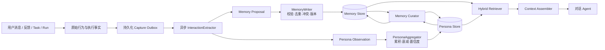

# AHF Runtime 长期记忆与用户画像设计

> 版本：v1.0  
> 状态：设计稿，待评审  
> 日期：2026-11-04  
> 范围：Runtime 长期记忆、用户行为证据、人格画像、异步抽取、检索与治理  
> 相关文档：`docs/runtime/AHF_RUNTIME_MEMORY.md`、`docs/用户行为流设计文档.md`、`docs/runtime/AGENT_P0_P3_IMPLEMENTATION_PLAN.md`

## 1. 结论

Agent 长期记忆不是在上下文窗口之外无限堆叠对话，而是在固定窗口外维护一条受治理的数据闭环：

```text
原始行为与执行事实
  → 写入门控
  → 结构化事实/事件/人格证据
  → 持久化与索引
  → 作用域安全的混合检索
  → 冲突消解与预算注入
  → 反思、合并、衰减与遗忘
```

系统需要同时回答两类问题：

1. **任务问题**：当前任务需要知道什么事实、决策、约束和经验？
2. **用户问题**：这个用户是谁，如何沟通、反馈、判断和协作更合适？

二者不能混成一张无差别记忆表。事实记忆追求明确、可验证、可替代；人格画像追求证据累积、场景相关、可衰减和可纠正。

### 1.1 核心决定

- 闲聊、感谢、生气、批评和反馈不是噪声。它们可以不进入事实记忆，但必须进入行为证据抽取。
- LLM 只提出记忆和人格观察，不能直接获得数据库写权限；作用域、状态、版本、来源和确认策略由 Runtime 决定。
- 首版使用“异步 Extractor + 确定性聚合器 + 低频 Curator”，不建设有自主写权限的 Memory Agent。
- 单次愤怒只能形成受场景约束的瞬时证据，不能直接固化为“用户易怒”等稳定人格判断。
- 所有召回先执行租户和用户硬隔离，再进行相关性排序。
- 当前代码、Git、测试、工具返回、GoalContract 和审计事实始终优先于记忆与画像。

## 2. 设计目标与非目标

### 2.1 目标

- 跨会话、跨任务召回明确事实、偏好、决策、约束和可复用经验。
- 从问答、闲聊、感谢、批评、情绪反应、评分、打断和授权行为中提取画像证据。
- 降低上下文 token 消耗，并避免陈旧、冲突、候选记忆进入模型上下文。
- 支持事实和画像的可追溯、纠正、删除、导出、重建与版本化。
- 在单用户本地部署和多租户部署下使用同一套硬隔离语义。
- 对写入可靠性、检索质量、画像准确性和隐私风险建立可回归的门禁。

### 2.2 非目标

- 首版不把全部对话原文直接写入向量库。
- 首版不允许对话 Agent 自由新增、覆盖或删除长期记忆。
- 首版不自动改写 system prompt，不自动上线程序性规则。
- 首版不依据单次表达进行心理诊断、政治立场推断或敏感属性推断。
- 首版不强制引入图数据库；先证明实体关系和多跳检索确有业务收益。
- 首版不建设独立常驻的自主记忆 Agent 进程。

## 3. 数据平面

| 平面 | 回答的问题 | 示例 | 生命周期 |
| --- | --- | --- | --- |
| 工作记忆 | 当前这一轮正在做什么？ | 当前消息、工具调用状态、临时计划 | 单轮/单会话 |
| 会话记忆 | 这个会话之前发生了什么？ | 最近对话、滚动摘要、未完成任务 | 会话级 |
| 情景记忆 | 过去某个任务如何发生、结果如何？ | 成功迁移、失败修复、关键工具证据 | 天到月，可衰减 |
| 语义记忆 | 哪些稳定事实、决策和偏好仍然有效？ | 技术栈、代码规范、部署约束 | 长期，直到失效 |
| 程序性记忆 | 哪些经过验证的做法可以复用？ | 发布检查流程、故障诊断步骤 | 长期，必须版本化 |
| 人格证据 | 这次交互透露了什么行为信号？ | 对长回答不满、被纠正时的反应 | 天到月 |
| 用户画像 | 多次证据说明了什么稳定倾向？ | “复杂问题偏好结论先行” | 周月，持续衰减 |
| 项目黑板 | 当前项目是什么、做到哪里？ | 架构、状态、已知问题、下一步 | 绑定项目版本 |
| 审计事实 | 当时谁授权、执行了什么？ | 审批、事件哈希、工具副作用 | 按审计策略保留 |

关键边界：

- **原始行为流**是可追溯证据，不等于长期记忆。
- **人格观察**是一次或一组交互的解释性证据，不等于稳定画像。
- **人格画像**是多次证据聚合结果，必须能回到证据。
- **项目黑板**是项目知识摘要，不替代源码、Git 和测试。
- **审计轨迹**不能作为模型推理事实被普通记忆召回。

## 4. 第一性原理约束

### 4.1 记忆是索引，不是真相源

关键事实仍以当前文件、Git、测试、工具返回和审计事件为准。记忆用于快速定位和提供历史背景，不能覆盖当前可验证事实。

### 4.2 证据先于结论

每条长期事实、人格观察和稳定画像必须记录：

- 来源；
- 时间；
- 作用域；
- 置信度；
- 证据引用；
- 分析器或抽取器版本。

无法回溯的证据不能用于高置信度画像。

### 4.3 LLM 提议，Runtime 提交

抽取模型只输出结构化候选。Runtime 负责：

- 注入可信租户、用户和项目作用域；
- 校验证据是否存在；
- 过滤敏感信息；
- 去重；
- 生成内容哈希；
- 决定 candidate/active；
- 应用版本和冲突规则。

### 4.4 明确表达优先于模型推断

优先级从高到低：

1. 用户当前明确陈述和纠正；
2. 用户确认的候选；
3. 工具或系统可验证事实；
4. 多次一致的行为证据；
5. 单次模型推断。

低优先级内容不能静默覆盖高优先级内容。

### 4.5 写入、召回和遗忘必须协同设计

只优化召回会放大噪声；只优化存储会忽略相关性；只做淘汰会丢失重要长期事实。三者必须共享同一套作用域、时间、置信度和状态语义。

### 4.6 瞬时情绪不等于稳定人格

“用户这次生气”和“用户通常不喜欢某类回答”是不同事实。前者用于当前和近期交互调整，后者必须经过重复证据聚合。

## 5. 当前实现审计

审计日期：2026-11-04。

### 5.1 已具备的基础

| 能力 | 当前实现 | 评价 |
| --- | --- | --- |
| 记忆数据模型 | `MemoryItem` 具备 kind、scope、provenance、TTL、version、supersedes | 基础方向正确 |
| 持久化 | `SqliteMemoryStore` 与进程内实现 | 可用于本地基础版 |
| 用户治理 | 显式写入、候选、确认、纠正、tombstone | P0 治理闭环已成立 |
| 运行时接线 | Task 前召回，Task 后写入 Goal、回答和工具事实 | 已形成最小闭环 |
| 用户行为流 | `UserBehaviorStore` 追加记录输入、反馈、授权和打断 | 原始证据层已有 |
| 项目记忆 | `ProjectBlackboardService` 保存项目结构和状态 | 可作为项目语义层基础 |
| 评测接口 | 已有 Recall@K、Precision、stale、leak 等字段 | 仅有接口，缺真实生产者 |

### 5.2 主要缺口

| 缺口 | 当前影响 | 等级 |
| --- | --- | --- |
| `unionScope` 按字段独立查询后求并集 | 共享项目可能串入其他用户记录 | 阻断 |
| `pending_confirmation` 记录仍为 active 并可召回 | 未确认推断可能进入上下文 | 阻断 |
| Runtime 未设置 MemoryManager token 预算 | 最多 20 条原文，但 token 无上限保证 | 高 |
| 自动写入没有抽取门控 | Goal、回答、工具事实直接成为长期记忆 | 高 |
| SQLite recall 先全表读取再过滤 | 数据量增长后延迟不可控 | 高 |
| 召回只有词法重合和简单加权 | 同义、否定、计数和多跳能力弱 | 高 |
| 没有异步可靠任务队列 | 抽取失败、进程重启时无可恢复保证 | 高 |
| 没有自动冲突消解和有效时间区间 | 新旧事实可能同时注入 | 高 |
| 没有访问反馈和主动遗忘 | 低价值记忆持续膨胀 | 中高 |
| 人格画像仅有机计数 | 闲聊、感谢、批评中的语义信号未利用 | 高 |
| 没有反思与程序性记忆 | 情景经验无法压缩成可复用规则 | 中 |
| 记忆评测指标没有实际生产者 | 无法证明质量改善 | 高 |

### 5.3 当前判断

当前系统是“受控的跨会话情景记忆 + 用户偏好治理 + 项目黑板”的 P0/P1 基础版，不是完整的自适应长期记忆系统。

在生产化前，必须先解决租户隔离、候选泄漏和 token 预算，再建设自动抽取与语义检索。

## 6. 目标架构



### 6.1 后台角色

#### InteractionExtractor

- 输入：一个明确的交互批次，例如一次反馈、一个 Task 完成或一次 Run 完成。
- 输出：`MemoryProposal[]` 与 `PersonaObservation[]`。
- 约束：单次模型调用、严格 JSON、不调用外部工具、不直接写库。

#### MemoryWriter

- 作用域由 Runtime 注入；
- 校验证据引用、敏感信息和 schema；
- 执行内容哈希去重；
- 决定 candidate/active；
- 处理版本、替代和冲突；
- 写入记忆与证据关系。

#### PersonaAggregator

- 不依赖 LLM；
- 按维度累积人格观察；
- 进行时间衰减、置信度计算和相反证据处理；
- 在达到阈值后生成稳定画像；
- 保留证据引用和画像版本。

#### MemoryCurator

- 低频、异步执行；
- 合并重复 Episode；
- 将多次经历压缩成语义事实；
- 提出程序性规则候选；
- 清理过期、低价值和冲突记忆；
- 不自动修改 system prompt。

### 6.2 是否需要单独 Agent

| 方案 | 结论 |
| --- | --- |
| 当前对话 Agent 通过工具自由写记忆 | 不采用。权限过大，易重复、越权、自我强化 |
| 独立异步 Extractor + Aggregator | 首版采用。职责窄、可测试、失败可重试 |
| 独立 Memory Curator | 第二阶段采用。低频反思，写操作仍受校验层约束 |
| 长期自主 Memory Agent | 暂不采用。仅在长跑型主动 Agent 有明确收益后评审 |

“独立”指执行单元和权限边界独立，不等于让另一个 LLM Agent 自主决定一切。

## 7. 数据模型

以下模型是目标态；实现时应保持现有 `MemoryItem` 对外兼容，通过增量迁移扩展。

### 7.1 作用域

所有记忆、人格证据、任务与画像都必须带可信作用域：

```ts
interface MemoryScope {
  tenantId: string;          // 多租户硬边界，本地部署也必须显式存在
  userId: string;
  workspaceId?: string;
  projectId?: string;
  conversationId?: string;
  rootGoalId?: string;
}
```

作用域由已认证执行上下文注入，不接受抽取模型或客户端任意覆盖。

### 7.2 MemoryItem 扩展

```ts
interface MemoryItemV2 {
  id: string;
  kind: 'turn' | 'summary' | 'fact' | 'preference' | 'episode' | 'decision' | 'procedure';
  text: string;
  scope: MemoryScope;
  entityKey?: string;        // 如 project:p1:database
  attribute?: string;        // 如 value / owner / deadline
  status: MemoryStatus;
  provenance: MemoryProvenance;
  validFrom: number;
  validTo?: number;
  expiresAt?: number;
  supersedes?: string[];
  supersededBy?: string;
  contradicts?: string[];
  sourceRefs: MemorySourceRef[];
  importance: number;
  accessCount: number;
  lastAccessedAt?: number;
  contentHash: string;
  version: number;
  extractorVersion: string;
  embeddingStatus?: 'pending' | 'ready' | 'failed';
}
```

`candidate` 应成为独立状态，不得再用 `active + pending_confirmation` 表达。

### 7.3 MemorySourceRef

```ts
interface MemorySourceRef {
  sourceKind:
    | 'input'
    | 'feedback'
    | 'tool_result'
    | 'task_completed'
    | 'run_completed'
    | 'user_correction'
    | 'project_blackboard';
  sourceId: string;
  sourceTs?: number;
  snapshotHash?: string;
}
```

证据引用必须能在原始行为流、Goal/Task/Step 或项目黑板中找到。删除原始来源时必须触发下游记忆和画像重建或失效。

### 7.4 PersonaObservation

人格观察描述“这个场景发生了什么反应”，不直接描述“用户是什么人”。

```ts
interface PersonaObservation {
  id: string;
  scope: MemoryScope;
  dimension:
    | 'communication.concision'
    | 'communication.directness'
    | 'communication.format'
    | 'epistemic.evidence'
    | 'decision.autonomy'
    | 'feedback.patience'
    | 'feedback.correction_style'
    | 'values.boundary'
    | string;
  signal: string;
  trigger?: string;
  context?: string;
  polarity: 'positive' | 'negative' | 'mixed' | 'neutral';
  strength: number;          // 0-1，一次观察的强度
  confidence: number;        // 0-1，对该观察解释的置信度
  stability: 'transient' | 'repeated' | 'explicit';
  sourceRefs: MemorySourceRef[];
  observedAt: number;
  expiresAt?: number;
  extractorVersion: string;
}
```

示例：

```json
{
  "dimension": "communication.concision",
  "signal": "prefers_concision",
  "trigger": "long_answer",
  "context": "technical_explanation",
  "polarity": "negative",
  "strength": 0.85,
  "confidence": 0.8,
  "stability": "transient"
}
```

不能直接从这句话输出“用户易怒”或“用户人格暴躁”。

### 7.5 PersonaTrait

```ts
interface PersonaTrait {
  id: string;
  scope: Pick<MemoryScope, 'tenantId' | 'userId'>;
  dimension: string;
  value: unknown;
  confidence: number;
  evidenceCount: number;
  distinctContexts: number;
  firstObservedAt: number;
  lastObservedAt: number;
  halfLifeDays: number;
  status: 'candidate' | 'established' | 'superseded' | 'tombstoned';
  supportingEvidence: string[];
  contradictingEvidence: string[];
  aggregatorVersion: string;
  version: number;
}
```

### 7.6 MemoryJob

异步抽取必须使用持久化 Outbox，而不是 `void promise`、内存数组或定时器独占的临时任务。

```ts
interface MemoryJob {
  jobId: string;
  kind: 'capture' | 'persona-aggregate' | 'reflect' | 'reindex' | 'expire';
  scope: MemoryScope;
  sourceRef: MemorySourceRef;
  sourceVersion: string;
  snapshotHash: string;
  status: 'pending' | 'running' | 'done' | 'failed' | 'dead';
  attempts: number;
  availableAt: number;
  lockedUntil?: number;
  lastError?: string;
  extractorVersion: string;
  createdAt: number;
  updatedAt: number;
}
```

唯一键建议：

```text
tenantId + sourceKind + sourceId + sourceVersion + extractorVersion
```

## 8. 写入门控

### 8.1 所有交互先保留证据

用户输入、反馈、评分、打断、授权和关键工具事实先追加到原始行为/执行事实层。此步骤不做语义判断，不依赖 LLM。

### 8.2 确定性预过滤

调用 LLM 前先过滤：

- 超长工具日志可截断或仅引用；
- 明确 secret、凭据和个人敏感信息脱敏；
- 重复事件按来源和内容哈希跳过；
- 无新增信息的重试、轮询和相同错误不重复抽取；
- 纯控制命令可只保留执行事实，不生成人格观察。

预过滤不能把闲聊和负反馈直接丢弃。它们只是不默认生成事实记忆。

### 8.3 LLM 抽取

建议输入：

- 本批用户输入和反馈；
- 最终回答摘要与 key tool facts；
- 已存在的相近事实/画像候选；
- 作用域元数据；
- 严格的抽取策略和 JSON schema。

建议输出：

```json
{
  "memories": [
    {
      "kind": "preference",
      "text": "用户要求复杂回答先给结论，再按需展开",
      "entityKey": "user:u1:answer_style",
      "attribute": "structure",
      "importance": 0.9,
      "confidence": "confirmed",
      "evidence": ["feedback:c123"]
    }
  ],
  "personaSignals": [
    {
      "dimension": "communication.concision",
      "signal": "prefers_concision",
      "trigger": "long_answer",
      "polarity": "negative",
      "strength": 0.85,
      "confidence": 0.8,
      "stability": "transient",
      "evidence": ["feedback:c123"]
    }
  ]
}
```

模型不得输出或修改：

- tenantId、userId、projectId；
- 数据库内部 ID；
- tombstone；
- 权限和审批状态；
- 已经确认的高优先级记忆；
- 原始 secret。

### 8.4 写入门控规则

默认记入长期事实：

- 用户明确、长期有效的偏好；
- 明确纠正与决策；
- 项目约束和不可违反的边界；
- 工具验证过的环境事实；
- 稳定完成或反复使用的流程。

默认形成人格证据：

- 感谢和满意；
- 生气、失望和批评；
- 纠正 Agent 的理解；
- 对长度、格式、语气、确认方式的反馈；
- 重复拒批、打断或加速请求；
- 闲聊中反复表达的兴趣和背景。

默认不生成事实记忆：

- 寒暄、口头禅和一次性情绪；
- 临时状态；
- 模型猜测；
- 无证据的评价；
- 重复工具输出；
- 敏感凭据和个人隐私，除非有明确政策与用户授权。

### 8.5 正式记忆与候选记忆

- 用户明确陈述：可直接生成 confirmed 候选，由 Runtime 完成校验和写入。
- 用户确认：候选转为 active。
- 系统或工具事实：只有在来源可验证时成为 active。
- 模型推断：默认 candidate，不参与跨会话召回。
- 用户纠正：旧事实关闭 `validTo`，新事实记录 `supersedes`。

## 9. 人格画像设计

### 9.1 画像维度

起步维度：

| 维度 | 观察内容 | 示例证据 |
| --- | --- | --- |
| `communication.concision` | 简洁与详细偏好 | “太长”“先给结论” |
| `communication.directness` | 直接与委婉偏好 | 明确批评、要求不要客套 |
| `communication.format` | 表格、清单、代码、自然语言偏好 | 多次要求特定输出格式 |
| `epistemic.evidence` | 对证据和不确定性的要求 | 要求来源、测试、复核 |
| `decision.autonomy` | 希望自主执行还是先确认 | 频繁打断等待确认或要求先问 |
| `feedback.patience` | 对延迟、重试和错误的容忍 | 打断位置、抱怨频率 |
| `feedback.correction_style` | 被纠正时的偏好 | 喜欢直接指出、不喜欢重复解释 |
| `values.boundary` | 明确红线与隐私边界 | “不要自动发布”“不要读取某目录” |
| `interest.topic` | 长期关注主题 | 跨会话重复出现的项目/领域 |

维度注册表必须版本化。新增维度不能改变旧画像的语义。

### 9.2 瞬时、重复与明确

- `transient`：单次情绪或场景反应，默认 1-14 天衰减。
- `repeated`：同维度、同语境重复出现，进入 30-180 天聚合。
- `explicit`：用户直接表达的偏好或边界，长期有效，直到被替代或删除。

### 9.3 聚合公式

```text
traitScore =
  Σ(observationStrength × sourceTrust × timeDecay)
  / Σ(sourceTrust × timeDecay)
```

```text
timeDecay = 0.5 ^ (ageDays / halfLifeDays)
```

聚合时同时考虑：

- 证据数量；
- 不同场景数量；
- 来源可信度；
- 正负证据比例；
- 最近观察时间；
- 用户明确确认；
- tombstone 和删除策略。

### 9.4 进入稳定画像的门槛

建议初始门槛：

- 同一维度至少 3 条独立证据；
- 至少 2 个不同场景，或用户明确确认；
- confidence ≥ 0.7；
- 没有同等强度的相反证据；
- 不包含已删除证据。

门槛必须配置化，并通过黄金集校准，不能写死为业务真理。

### 9.5 反过拟合

- 不因单次生气形成负面人格标签；
- 不把工作压力、短期情绪当作稳定偏好；
- 不根据隐含敏感属性做推断；
- 明确区分“这次场景中的反应”和“跨场景倾向”；
- 所有画像结论必须能展开到原始证据；
- 相反证据应降低置信度，而不是直接丢弃；
- 长期无新证据的画像必须衰减。

## 10. 异步流程与可靠性

### 10.1 触发点

| 事件 | 动作 |
| --- | --- |
| 用户明确说“记住/以后/不要” | 立即持久化 capture job，进入高优先级队列 |
| 用户提交反馈或评分 | 持久化 persona/capture job |
| Task 完成 | 抽取任务事实、工具证据、失败/成功经验 |
| Run 完成 | 聚合、冲突检查、项目黑板更新 |
| 达到阈值/定时 | 触发 Curator、画像合并、老化与清理 |

不对 token 流逐块抽取，不阻塞当前回答。

### 10.2 Outbox 事务

源事实和 capture job 应在同一数据库事务中落库：

```text
append source fact
  + append memory_job
  + commit
  → 返回用户
```

LLM 网络调用不能包在事务中。

### 10.3 Worker 领取与幂等

- Worker 通过租约领取 pending job；
- 同一 job 只能由一个 Worker 执行；
- 失败按指数退避重试；
- 超过最大次数进入 dead，等待人工或诊断任务；
- 结果写入使用幂等键；
- 进程重启后可以继续未完成任务；
- 每租户限制并发和 token 成本。

### 10.4 失败隔离

- 记忆抽取失败不影响用户回答和 Task 结果；
- 失败必须记录错误、attempts、模型和 prompt 版本；
- 可重放任务时使用相同 source snapshot；
- 不允许静默丢任务；
- 用户删除来源后，旧任务必须被取消或重建失效证据。

## 11. 冲突、时间与遗忘

### 11.1 首版 ADD-only

抽取模型只提出新增事实。Runtime 根据 `entityKey + attribute + scope` 执行：

- 完全相同：NOOP；
- 相似且信息不冲突：合并或建立链接；
- 同一属性新事实替代旧事实：关闭旧记录 `validTo`；
- 无法判断：保留冲突并禁止自动注入；
- 低置信度：candidate；
- 用户纠正：显式 supersedes。

首版不建议让单个 LLM 调用同时执行 ADD/UPDATE/DELETE，因为状态变更需要确定性规则和可回归测试。

### 11.2 时间语义

- `createdAt`：系统记录时间；
- `validFrom/validTo`：事实在业务上有效的区间；
- `lastAccessedAt`：最近召回时间；
- `expiresAt`：硬过期时间；
- `tombstoned`：用户要求删除；
- `deprecated`：被新事实替代但保留历史。

系统必须支持“过去是什么、现在是什么”的查询。

### 11.3 遗忘策略

- 用户明确删除：立即 tombstone，不再召回；
- 硬 TTL：到期后从默认索引移除，按策略归档；
- 时间衰减：影响排序，不等于删除；
- 访问反馈：频繁有效召回强化，长期未用衰减；
- 合并：相似 Episode 压缩为摘要或 semantic fact；
- 垃圾回收：删除无证据、低价值、长期未访问的派生索引。

原始证据和派生记忆必须有分别的保留策略。删除派生画像不能自动删除审计证据；删除原始证据必须使依赖它的派生结论失效。

## 12. 检索与上下文注入

### 12.1 硬过滤优先

检索顺序必须先是安全条件，再是相关性：

```text
tenantId = currentTenant
AND userId = currentUser
AND status = active
AND validNow
AND (scope-specific OR global)
AND sensitivity allowed
```

`project`、`workspace` 和 `conversation` 只能作为同一租户/用户下的候选集合，不能用独立查询结果无约束取并集。

### 12.2 混合召回

推荐目标链路：

```text
metadata hard filter
  → FTS/BM25
  → embedding ANN
  → RRF fusion
  → reranker
  → recency/importance/confidence modulation
  → token packing
```

向量检索不能替代：

- 明确实体关系；
- 计数和枚举；
- 否定与时效；
- 多跳查询；
- 作用域权限过滤。

### 12.3 预算

建议默认分层：

| 内容 | 默认预算 |
| --- | --- |
| 常驻事实与红线 | ≤ 300 tokens |
| 动态任务记忆 | ≤ 800 tokens |
| 人格交互指导 | ≤ 250 tokens |
| 完整 Episode 原文 | 不默认注入，改用摘要/证据指针 |

项目可通过配置调整，但必须有绝对上限和实际使用审计。

### 12.4 注入格式

事实记忆建议注入为结构化 block，而不是把旧对话伪装成当前 user/assistant 消息：

```text
[长期记忆 | 来源：用户明确 | 更新时间：... | 置信度：高]
- 复杂问题先给结论，再按需展开。
- 项目数据库使用 PostgreSQL，旧 MySQL 结论已于 ... 失效。
```

人格画像应注入为交互建议，不作为绝对事实：

```text
[交互偏好证据 | 置信度 0.82 | 最近 30 天 4 次]
- 复杂说明通常先给结论；用户要求更长内容时再展开。
- 不要在回答中主动展示或讨论该画像。
```

禁止把“用户愤怒原话”直接注入后续所有会话。需要时只注入抽象后的场景规则，并通过 sourceRefs 追溯。

## 13. 用户治理与隐私

### 13.1 用户可见

用户必须能够：

- 查看事实记忆和画像结论；
- 查看证据、时间、来源和置信度；
- 确认模型候选；
- 纠正或否定画像；
- 暂停某类画像学习；
- 删除单条证据或某个维度的全部证据；
- 导出和重建画像；
- 清除原始行为流。

### 13.2 多租户

- 所有查询必须带 tenantId 和 userId；
- Memory API 不允许客户端自行指定其他用户；
- PATCH/DELETE 必须验证记录所有权；
- project/workspace 共享不能绕过用户边界；
- 导入 bundle 必须重新绑定当前租户并检查冲突；
- 日志、评测和错误信息不能泄漏跨租户内容。

### 13.3 敏感信息

- secret 进入原始行为流前必须脱敏或换取 voucher；
- 人格画像默认不保存敏感原话；
- 禁止从对话推断心理疾病、政治立场、性取向等敏感属性；
- 高风险画像维度必须显式配置并在 UI 中可关闭；
- 删除权利必须传播到证据、画像、索引和缓存。

## 14. 评测与门禁

### 14.1 事实记忆指标

- Precision@K；
- Recall@K；
- stale injection rate；
- conflict injection rate；
- cross-tenant leak count；
- candidate leakage count；
- context token cost；
- retrieval p50/p95 latency；
- extraction success/retry rate；
- duplicate rate；
- 用户纠错后的旧事实残留率。

### 14.2 人格画像指标

- 画像维度准确率；
- 证据覆盖率；
- 证据真实性；
- 单次信号误升级率；
- 相反证据后置信度下降是否生效；
- 删除证据后的画像重建正确率；
- 明确偏好覆盖率；
- 人格注入对任务成功率和满意度的影响；
- 过度推断率与敏感推断率。

### 14.3 黄金场景

最低必须覆盖：

1. 用户感谢简短回答，后续仍偏好简洁；
2. 用户因回答过长生气，一次后不直接固化为稳定人格；
3. 同类负反馈多次出现后，画像低置信度建立；
4. 用户明确说“以后先给结论”，立即成为 confirmed；
5. 用户先说 MySQL，后明确纠正为 PostgreSQL；
6. 30 天后召回旧项目但不会混入其他项目；
7. 候选记忆不进入上下文；
8. 删除证据后画像不再引用；
9. 跨用户、跨项目零泄漏；
10. Worker 重启后可继续抽取；
11. 同一来源重复抽取保持幂等；
12. 超预算时按优先级打包并记录丢弃原因。

### 14.4 外部基准

在黄金集稳定后，可接入 LoCoMo、LongMemEval 和 DMR 作为回归参考，但不能替代本系统自定义的隐私、隔离、人格误升级和时间冲突测试。

## 15. 实施边界

### 15.1 第一阶段必须先完成

- 修复作用域隔离；
- 候选记忆默认不可召回；
- 统一 token 预算；
- 建立持久化 Outbox 和可恢复 Worker；
- 增加安全与幂等回归。

### 15.2 第二阶段

- 自动抽取事实；
- 人格观察与聚合；
- 候选确认和治理 UI；
- 真实指标生产。

### 15.3 第三阶段

- BM25 + embedding + RRF + reranker；
- 自动冲突消解与有效时间查询；
- Curator、反思和程序性规则候选；
- 外部基准与持续回归。

## 16. 验收定义

设计进入实现前必须满足：

1. 本设计与现有 `AHF_RUNTIME_MEMORY.md` 的差异已明确；
2. 数据迁移保持现有 API 兼容；
3. 安全隔离和候选状态有专门测试；
4. 抽取器有 deterministic fake 和真实模型两个适配层；
5. 画像结论能回到真实证据；
6. 任何记忆或画像失败不阻塞主对话；
7. 用户对删除、纠正和关闭学习有明确控制；
8. 评测可在 CI 中离线运行。

记忆能力进入生产前必须满足：

1. 零跨用户/跨项目泄漏；
2. 零 pending 候选注入；
3. Worker 重启不丢任务；
4. 重复抽取幂等；
5. 预算上限可执行并留痕；
6. 删除证据后派生结论不继续召回；
7. 新旧事实冲突有确定规则；
8. 单次情绪不直接升级稳定人格；
9. Precision、Recall、stale 和 token 成本有可重复报告；
10. 用户可以从 UI/API 审计和治理自己的记忆与画像。
